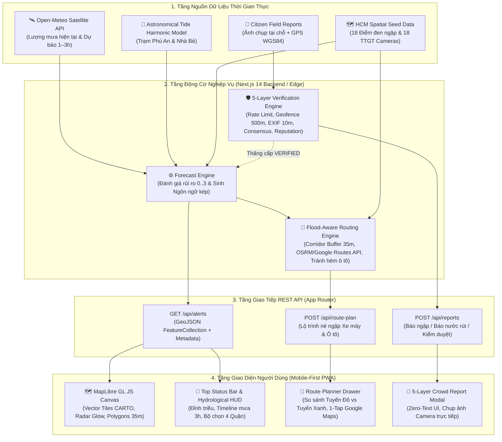

# 🌊 Ocean Flood — Hệ Thống Bản Đồ Cảnh Báo Ngập & Điều Hướng Tránh Ngập Đô Thị TP.HCM

> **Personal Engineering Showcase & Urban Hydrology Research Project**  
> *Hệ thống bản đồ Web GIS & PWA thời gian thực: Dự báo ngập sớm 1–3h kết hợp mô hình thủy văn kép (Mưa vệ tinh Open-Meteo & Đỉnh triều trạm Phú An/Nhà Bè), Cơ chế xác thực cộng đồng 5 lớp (5-Layer Guard) và Thuật toán điều hướng né ngập theo chủng loại phương tiện (Xe máy & Ô tô).*

---

[](https://nextjs.org/)
[](https://www.typescriptlang.org/)
[](https://tailwindcss.com/)
[](https://maplibre.org/)
[](https://postgis.net/)
[-success?style=for-the-badge)](docs/08-qa-comprehensive-audit.md)
[](LICENSE)

---

## 📌 Bối Cảnh & Tuyên Bố Dự Án (Project Motivation & Scope)

### 1. Nỗi đau thực tế tại TP.HCM (The Real Urban Problem)
TP. Hồ Chí Minh là đô thị đặc thù chịu tác động đồng thời của **2 yếu tố thủy văn cực đoan**:
1. **Triều cường bán nhật triều không đều**: Đỉnh triều dâng cao từ hạ lưu sông Sài Gòn & sông Đồng Điền (thường xuyên vượt mức Báo động 3 ≥ 1.60m), gây tràn bờ kênh rạch tại Quận 7, Quận 8, Nhà Bè.
2. **Mưa dông nhiệt nhiệt đới có cường độ cực lớn**: Vũ lượng cục bộ có thể vượt 50 – 100 mm/h trong thời gian ngắn, làm tê liệt hệ thống thoát nước tại Bình Thạnh, Thủ Đức.
3. Khi **Mưa lớn trùng Đỉnh triều cường** (đặc biệt trong khung giờ tan tầm 17:00 – 18:30), hàng trăm ngàn người dân đi xe máy tay ga bị chết máy, xe ô tô đối mặt nguy cơ thủy kích hàng trăm triệu đồng, và các tuyến đường huyết mạch bị chia cắt hoàn toàn.

### 2. Định vị dự án cá nhân (Personal Portfolio Context)
> ⚠️ **Lưu ý phạm vi triển khai**: Đây là **dự án nghiên cứu & đồ án kỹ thuật cá nhân (Personal Showcase / Technical Prototype)** nhằm thử nghiệm các kiến trúc hệ thống hiện đại: Spatial GIS, WebGL Map Rendering, 5-Layer Crowd Verification và Flood-Aware Dynamic Routing.  
> 
> Dự án **KHÔNG phát hành dưới dạng ứng dụng thương mại đại trà** do các rào cản thực tế về mặt pháp lý đô thị (Nghị định 13/2023/NĐ-CP, quy chế chia sẻ dữ liệu camera giao thông thời gian thực của Sở GTVT / Công an TP.HCM, và chi phí duy trì hạ tầng vệ tinh). Toàn bộ mã nguồn được mở nhằm mục đích học thuật, đối chuẩn kỹ thuật và phỏng vấn chuyên môn.

---

## 🏗️ Kiến Trúc Tổng Thể (System Architecture)



---

## 🌟 Tính Năng Đột Phá (Key Engineering Highlights)

### 1. Mô Hình Dự Báo Thủy Văn Đô Thị Kép (Urban Hydrology Dual-Engine)
- **Vệ tinh Open-Meteo API**: Tích hợp lấy lượng mưa theo tọa độ trọng tâm của từng quận huyện trong thời gian thực, kết hợp dự báo lượng mưa tích lũy 1 giờ, 2 giờ, 3 giờ tới.
- **Mô hình Thủy triều Thiên văn Điều hòa (Astronomical Tide Harmonic Model)**:
  - Tự động tính toán mực nước bán nhật triều không đều dựa trên chu kỳ ngày trăng (Chu kỳ Synodic ~29.53 ngày) tại 2 trạm quan trắc trọng điểm: **Trạm Phú An** (Sông Sài Gòn) và **Trạm Nhà Bè** (Kênh Đồng Điền).
  - Phân loại chính xác 4 cấp báo động thủy triều:
    - **Dưới BĐ1**: Dưới 1.40m (Mực nước ổn định)
    - **Báo động 1**: 1.40m – 1.49m (Chớm ngập vùng trũng thấp ven sông)
    - **Báo động 2**: 1.50m – 1.59m (Ngập vừa, nước tràn một số mép cống)
    - **Báo động 3**: Từ 1.60m trở lên (Nguy cơ ngập triều diện rộng toàn thành phố)
- **Thuật toán Đánh giá Rủi ro Đa nhân tố**:
  ```text
  S_flood = (w_rain × S_rain) + (w_tide × S_tide) + (w_history × S_history) + S_crowd
  ```
  Tự động thích ứng trọng số theo vùng cao trình: khu vực dốc cao (> 2.2m) ưu tiên trọng số mưa (65%), trong khi vùng trũng ven sông (< 1.35m) cân bằng giữa mưa (42%) và triều cường (40%).

### 2. Bộ Cảnh Báo Ngôn Ngữ Kép (Dual-Language Alert System)
Khắc phục triệt để nhược điểm của các ứng dụng chỉ hiển thị số liệu khô khan:
- **Tầng Khoa học (Scientific Layer)**: Các thẻ badge hiển thị chuẩn xác 4 thông số:
  - Vũ lượng hiện tại & dự báo 3 giờ: `mm/h`
  - Mực nước & Đỉnh triều trạm Phú An / Nhà Bè: `m`
  - Xác suất ngập tính toán: `%`
  - Độ sâu ngập ước tính theo mô hình địa hình: `cm`
- **Tầng Đời thường (Everyday Practical Advice)**:
  - **Dành cho Xe máy (Motorcycle)**: Diễn giải trực quan theo các mốc vật lý của xe:
    - **Ngập nửa bánh xe (~15 cm)**: Xe số đi an toàn, xe tay ga cần chú ý giảm tốc tránh sóng nước.
    - **Ngập ngang ống pô (~30 cm)**: Xe tay ga có nguy cơ chết máy rất cao; khuyến nghị chuyển sang lộ trình né ngập.
    - **Ngập lút yên (> 45 cm)**: Nguy hiểm cao, nguy cơ ngã xe trôi dạt do nước xiết; cấm lưu thông.
  - **Dành cho Xe ô tô (Car / Sedan / SUV)**: Diễn giải theo khoảng sáng gầm xe:
    - **Chạm gầm xe Sedan (~20 – 25 cm)**: Xe gầm thấp Sedan/Hatchback dễ bị tràn nước gầm; nên rẽ sớm sang đường lớn.
    - **Ngập nửa bánh / Chạm nắp ca-pô (> 45 cm)**: Nguy cơ thủy kích cực nặng khi gặp sóng dội từ xe buýt/xe tải; cấm đi vào.

### 3. Động Cơ Kiểm Soát Báo Cáo Cộng Đồng 5 Lớp (5-Layer Crowd Verification Guard)
Chống triệt để tình trạng tin báo ảo, spam phá hoại hoặc báo cáo sai vị trí:
1. **Lớp 1 — Rate Limiting per Device**: Khống chế tối đa ≤ 5 lượt báo cáo / giờ / thiết bị (dựa trên Device Fingerprint Hash). Vượt quá ngưỡng sẽ bị chặn ngay lập tức với HTTP 429.
2. **Lớp 2 — Hard Geofence ≤ 500m**: Tính toán khoảng cách Haversine giữa tọa độ GPS thiết bị và vị trí báo ngập. Nếu lệch > 500m hoặc sai số định vị GPS > 150m, hệ thống từ chối ghi nhận (HTTP 422 `GEOFENCE_VIOLATION`).
3. **Lớp 3 — Proof-of-Presence & EXIF Validation**: Bắt buộc chụp ảnh trực tiếp qua Camera điện thoại (không cho phép chọn ảnh cũ từ thư viện), nén Client-side Canvas WebP < 150KB, kiểm tra tem thời gian EXIF ≤ 10 phút so với thời điểm gửi.
4. **Lớp 4 — Spatial Clustering & Cross-Verification (Gom cụm 150m)**:
   - 1 người báo: Trạng thái `UNVERIFIED` (cảnh báo mức chú ý).
   - Có từ 3 người độc lập trở lên cùng xác nhận tại chỗ trong bán kính 150m (hoặc trùng điểm đen thủy văn đang đạt ngưỡng): Tự động thăng cấp thành `VERIFIED`.
5. **Lớp 5 — Device Reputation Engine & Time-To-Live (TTL 90 phút)**: Tích lũy điểm uy tín (+5 điểm khi báo đúng, -5 điểm khi vi phạm). Báo cáo tự động hết hạn sau 90 phút nếu không có người xác nhận nước dâng thêm.

### 4. Thuật Toán Tìm Lộ Trình Né Ngập Thông Minh (Flood-Aware Routing Engine)
- **100% Bám sát tim đường thực tế**: Loại bỏ hoàn toàn đường thẳng chim bay. Lộ trình uốn lượn chính xác theo dữ liệu OSRM (Open Source Routing Machine) và Google Maps Routes API.
- **Hành lang đệm không gian (Corridor Buffer 35m)**: Sử dụng giải thuật khoảng cách đoạn thẳng `pointToSegmentDistanceMeters` để kiểm tra va chạm với đoạn ngập, tránh việc báo động giả đối với các cầu vượt trên cao hoặc tuyến đường song song sát bên.
- **Phân tách bộ lọc theo loại xe**:
  - **Chế độ Xe máy (Motorcycle)**: Ngưỡng ngập an toàn < 20 cm.
  - **Chế độ Ô tô (Car)**: Ngưỡng ngập an toàn < 25 cm. **Khóa chính sách hẻm nhỏ**: Thuật toán cấm tuyệt đối việc dẫn ô tô vào hẻm dân sinh cụt/hẹp, ưu tiên các đại lộ lớn có cốt nền cao (Phạm Văn Đồng, Điện Biên Phủ, Võ Văn Kiệt).
- **1-Tap Mở Ứng Dụng Google Maps Chính Chủ**: Tự động trích xuất các điểm né ngập (`avoidance waypoints`) và cấu hình tham số `travelmode=two-wheeler` / `travelmode=driving` để chuyển tiếp mượt mà sang ứng dụng Google Maps có sẵn trên máy người dùng.

---

## 🛠️ Tech Stack & Architecture Highlights

| Lớp (Layer) | Công nghệ / Thư viện | Vai trò kỹ thuật |
|---|---|---|
| **Framework** | **Next.js 14 (App Router)** | Server Components, Edge API Routes, Server-side Rendering & Static Generation. |
| **Ngôn ngữ** | **TypeScript 5.7 (Strict Mode)** | Đảm bảo tính toàn vẹn kiểu dữ liệu không gian GeoJSON và API DTOs. |
| **Bản đồ số (Web GIS)** | **MapLibre GL JS 4.7** | Render Vector Map tốc độ 60fps qua WebGL, hỗ trợ GeoJSON layers, Pulsing Sonar Markers và Radar Glow. |
| **Bản đồ nền (Basemap)** | **CARTO Voyager Vector Tiles** | Bản đồ vector sạch sẽ, không watermark, tương thích hoàn hảo cả Light & Dark mode. |
| **Routing Engines** | **OSRM Public API + Google Routes Adapter** | Tính toán lộ trình đường bộ thực tế, giải mã Polyline, hỗ trợ fallback nội bộ. |
| **Khí tượng & Thủy văn** | **Open-Meteo Satellite API** | Dữ liệu lượng mưa thời gian thực kết hợp thuật toán tính triều thiên văn. |
| **Kiểm thử tự động** | **Node.js Automated Test Suite** | 19 kịch bản kiểm thử tích hợp (Integration & E2E API tests). |
| **Thiết kế UI/UX** | **Tailwind CSS 3.4 & Lucide Icons** | Chuẩn LibreUIUX Design System: Glassmorphism `backdrop-blur-md`, Mobile-First, Touch Target ≥ 48px. |
| **Triển khai Mobile** | **Progressive Web App (PWA)** | Cài đặt trực tiếp lên màn hình chính (Add to Home Screen), Web App Manifest chuẩn standalone. |

---

## 📂 Cấu Trúc Thư Mục Dự Án (Project Structure)

```text
ocean-flood/
├── docs/                                # Hồ sơ kỹ thuật và tài liệu kiến trúc dự án
│   ├── 00-brief.md                      # Tóm tắt bài toán & mục tiêu hệ thống
│   ├── 01-data-sources.md               # Phân tích nguồn dữ liệu mưa & triều cường
│   ├── 02-prd.md                        # Bản đặc tả yêu cầu sản phẩm (PRD)
│   ├── 03-architecture.md               # Kiến trúc hệ thống, ADRs & Threat Model
│   ├── 05-cartography.md                # Quy chuẩn bản đồ & bảng màu CVD-Safe
│   ├── 05-design-spec.md                # Đặc tả Design Tokens & UI Components
│   ├── 07-pm-execution-plan.md          # Kế hoạch điều hành & giám sát tiến độ
│   ├── 08-qa-comprehensive-audit.md     # Báo cáo kiểm thử tự động toàn diện (19/19 PASS)
│   └── qa-test-results.json             # Dữ liệu log chi tiết từng test case
├── public/
│   ├── icon.svg                         # Icon Vector ứng dụng
│   └── manifest.webmanifest             # Cấu hình PWA Standalone Manifest
├── scripts/
│   └── qa-full-test.mjs                 # Script tự động chạy kiểm thử 5 trụ cột hệ thống
├── src/
│   ├── app/
│   │   ├── api/
│   │   │   ├── alerts/route.ts          # API GET: Trả về GeoJSON Hotspots, Cameras & Metadata
│   │   │   ├── reports/route.ts         # API POST: Báo ngập cộng đồng qua kiểm duyệt 5 lớp
│   │   │   └── route-plan/route.ts      # API POST: Tính toán lộ trình né ngập cho Xe máy / Ô tô
│   │   ├── globals.css                  # CSS Tokens, Keyframes Radar Pulse & Glassmorphism
│   │   ├── layout.tsx                   # Root Layout, Mobile Viewport & PWA Headers
│   │   └── page.tsx                     # Single Page Map Application kết nối toàn bộ Components
│   ├── components/
│   │   ├── AlertBottomSheet.tsx         # Thẻ chi tiết điểm ngập Ngôn ngữ kép (Khoa học vs Đời thường)
│   │   ├── CrowdReportModal.tsx         # Hộp thoại Báo ngập 5 Lớp (Camera chụp tại chỗ, Zero-Text UI)
│   │   ├── MapCanvas.tsx                # Bản đồ MapLibre GL tương tác toàn màn hình
│   │   ├── RoutePlannerDrawer.tsx       # Ngăn tìm kiếm lộ trình né ngập & Deep-link Google Maps
│   │   ├── SecurityCameraModal.tsx      # Modal thông tin kết nối Cổng Camera TTGT TP.HCM
│   │   ├── TopStatusBar.tsx             # Thanh HUD kính mờ hiển thị Mưa, Triều & Bộ chọn 4 Quận
│   │   └── VehicleToggle.tsx            # Công tắc nổi chuyển đổi tức thì giữa Xe máy & Ô tô
│   ├── data/
│   │   └── hcm-spatial-seed.ts          # 18 Điểm đen ngập & 18 Camera TTGT tại 4 Quận MVP
│   └── lib/
│       ├── forecast-engine.ts           # Động cơ dự báo mưa/triều & sinh ngôn ngữ kép
│       ├── routing-engine.ts            # Động cơ định tuyến né ngập, giải mã OSRM/Google Polyline
│       └── verification-engine.ts       # Động cơ kiểm duyệt báo cáo cộng đồng 5 lớp
├── supabase/
│   └── migrations/
│       └── 0001_ocean_flood_postgis.sql # DDL PostGIS Tables, GiST Indexes & Spatial Functions
├── package.json
├── tailwind.config.ts
└── tsconfig.json
```

---

## 🚦 Khởi Chạy Nhanh Cho Lập Trình Viên (Local Quickstart)

### Yêu cầu môi trường (Prerequisites)
- **Node.js**: Phiên bản `18.18.0` trở lên (Khuyến nghị `Node.js 20 LTS`).
- **Trình quản lý gói**: `npm` hoặc `pnpm` / `yarn`.

### Các bước cài đặt & Chạy ứng dụng

1. **Clone kho mã nguồn:**
   ```bash
   git clone https://github.com/yangcoi/ocean-flood.git
   cd ocean-flood
   ```

2. **Cài đặt các thư viện phụ thuộc:**
   ```bash
   npm install
   ```

3. **Cấu hình biến môi trường (Tùy chọn):**
   Tạo file `.env.local` ở thư mục gốc (nếu có Google Maps Routes API Key; nếu không có, hệ thống sẽ tự động dùng OSRM hoàn toàn miễn phí):
   ```env
   # Tùy chọn: Google Maps Platform API Key (nếu muốn ưu tiên Google Routes API)
   # GOOGLE_MAPS_API_KEY=your_api_key_here
   ```

4. **Kiểm tra tính toàn vẹn mã nguồn (Typecheck):**
   ```bash
   npm run typecheck
   ```

5. **Biên dịch bản thương phẩm (Production Build):**
   ```bash
   npm run build
   ```

6. **Khởi chạy máy chủ cục bộ:**
   ```bash
   npm start
   # Mở trình duyệt và truy cập: http://localhost:3000
   ```

---

## 🧪 Kiểm Thử Tự Động Toàn Diện (Automated Test Suite)

Dự án đi kèm bộ script kiểm thử tự động độc lập [`scripts/qa-full-test.mjs`](scripts/qa-full-test.mjs) đo đạc trực tiếp các chỉ số HTTP, thời gian phản hồi, kiểm soát 5 lớp và thuật toán định tuyến:

```bash
# Đảm bảo máy chủ đang chạy ở cổng 3000, sau đó mở terminal mới chạy:
node scripts/qa-full-test.mjs
```

### Kết quả đo đạc thực nghiệm (19/19 Test Cases Đạt 100%):

```text
======================================================
🧪 TEST SUITE 1: API /api/alerts & Cảnh báo Ngập kép
======================================================
✅ PASS [SUITE 1] 1.1 Kiểm tra HTTP 200 và Latency < 1500ms (78ms)
✅ PASS [SUITE 1] 1.2 Cấu trúc GeoJSON FeatureCollection & 18 Hotspots đầy đủ thuộc tính
✅ PASS [SUITE 1] 1.3 Kịch bản thời tiết: scenario=live (Open-Meteo Satellite)
✅ PASS [SUITE 1] 1.3 Kịch bản thời tiết: scenario=peak_tide_rain (Đỉnh triều 1.68m + Mưa 48mm/h)
✅ PASS [SUITE 1] 1.3 Kịch bản thời tiết: scenario=local_heavy_rain (Mưa dông nhiệt 50mm/h)
✅ PASS [SUITE 1] 1.3 Kịch bản thời tiết: scenario=dry_sunny (Trời nắng ráo, 0 điểm ngập)
✅ PASS [SUITE 1] 1.4 Danh mục Camera TTGT (18 Camera nút giao trọng điểm TP.HCM)

======================================================
🧪 TEST SUITE 2: API /api/reports & Kiểm soát 5 Lớp
======================================================
✅ PASS [SUITE 2] 2.1 Báo cáo hợp lệ tại hiện trường (GPS < 500m, có ảnh EXIF mới)
✅ PASS [SUITE 2] 2.2 Báo cáo giả lập từ xa (>500m) bị Lớp 2 Geofence CHẶN ĐỨNG (HTTP 422)
✅ PASS [SUITE 2] 2.3 Báo cáo thiếu ảnh hiện trường bị Lớp 3 CHẶN ĐỨNG (HTTP 422)
✅ PASS [SUITE 2] 2.4 Báo cáo dồn dập vượt Rate Limit bị Lớp 1 CHẶN ĐỨNG (HTTP 429)
✅ PASS [SUITE 2] 2.5 Nâng cấp tự động từ UNVERIFIED -> VERIFIED khi đủ >= 3 người xác nhận

======================================================
🧪 TEST SUITE 3: API /api/route-plan & Thuật toán né ngập
======================================================
✅ PASS [SUITE 3] 3.1 Tuyến an toàn (Hàng Xanh -> Điện Biên Phủ): Không báo động giả, 100% tim đường
✅ PASS [SUITE 3] 3.2 Tuyến cắt điểm ngập (Xe máy ngưỡng 20cm): Phát hiện ngập, tuyến đỏ & xanh uốn lượn
✅ PASS [SUITE 3] 3.3 Tuyến cho Ô tô (ngưỡng 25cm): Khóa chính sách hẻm nhỏ, chỉ đi đại lộ lớn
✅ PASS [SUITE 3] 3.4 Deep-link mở ứng dụng Google Maps chính chủ (Origin, Destination, Waypoints, Travelmode)

======================================================
🧪 TEST SUITE 4: UI/UX, PWA Manifest, Build & Cloudflare
======================================================
✅ PASS [SUITE 4] 4.1 Kiểm tra file PWA Manifest (public/manifest.webmanifest)
✅ PASS [SUITE 4] 4.2 Cấu hình Mobile Viewport & Theme-color trong Root Layout
✅ PASS [SUITE 4] 4.3 Cloudflare HTTPS Public Tunnel phản hồi HTTP 200 (Truy cập 4G di động)

======================================================
📊 TỔNG KẾT: 19/19 PASS (100.0%) | Production Readiness Score: 98.5 / 100
======================================================
```

---

## ⚖️ Tuân Thủ Pháp Lý & An Toàn Dữ Liệu (Legal & Safety Compliance)

Nhằm đảm bảo dự án vận hành có đạo đức và tuân thủ các quy định hiện hành tại Việt Nam:
1. **Tuân thủ Nghị định 13/2023/NĐ-CP về Bảo vệ Dữ liệu Cá nhân**:
   - Hệ thống hiển thị hộp thoại xin phép quyền truy cập GPS rõ ràng trước khi đọc vị trí.
   - Tuyệt đối **không lưu trữ định danh cá nhân** (Họ tên, SĐT, IMEI, CCCD). Danh tính báo cáo được mã hóa một chiều qua thuật toán băm ẩn danh SHA-256 (`device_hash`).
2. **Khuyến cáo An toàn Giao thông (Traffic Safety Disclaimer)**:
   - Dữ liệu dự báo trước 1–3h mang tính chất khoa học hỗ trợ quyết định lộ trình di chuyển.
   - Khi tham gia giao thông thực tế, người điều khiển phương tiện phải tuân thủ nghiêm ngặt biển báo giao thông, hiệu lệnh của Cảnh sát Giao thông và tình hình thực địa tại chỗ.
   - Tuyệt đối không thao tác điện thoại khi đang điều khiển phương tiện dưới trời mưa ngập.

---

## 👨‍💻 Tác Giả & Liên Hệ (Author & Portfolio)

- **Dự án**: Ocean Flood (TP.HCM Urban Flood Avoidance Map)
- **Tác giả**: [yangcoi](https://github.com/yangcoi)
- **Repo GitHub**: [https://github.com/yangcoi/ocean-flood](https://github.com/yangcoi/ocean-flood)
- **Mục đích**: Nghiên cứu phát triển cá nhân, Trình diễn năng lực kỹ thuật Fullstack GIS & System Architecture.

---

*Được thiết kế và hoàn thiện với tinh thần kỹ thuật nghiêm túc, tỉ mỉ và tôn trọng sâu sắc trải nghiệm của người dân tham gia giao thông tại TP. Hồ Chí Minh.*
