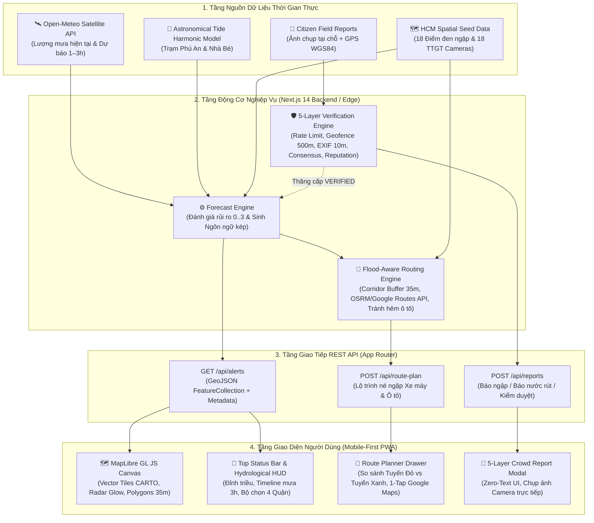

# 🌊 Ocean Flood

> **Hệ Thống Bản Đồ Cảnh Báo Ngập & Điều Hướng Tránh Ngập Đô Thị TP.HCM**  
> *Dự án kỹ thuật cá nhân (Personal Engineering Project & Prototype): Dự báo ngập sớm 1–3h kết hợp mô hình thủy văn kép (Mưa vệ tinh Open-Meteo & Đỉnh triều trạm Phú An/Nhà Bè), Cơ chế xác thực cộng đồng 5 lớp (5-Layer Verification) và Thuật toán điều hướng né ngập theo loại phương tiện (Xe máy & Ô tô).*

---

[](https://nextjs.org/)
[](https://www.typescriptlang.org/)
[](https://tailwindcss.com/)
[](https://maplibre.org/)
[](https://postgis.net/)
[-success?style=for-the-badge)](docs/08-qa-comprehensive-audit.md)
[](LICENSE)

---

## 📌 Bối Cảnh & Phạm Vi Kỹ Thuật (Context & Technical Scope)

### 1. Đặc thù bài toán thủy văn đô thị TP.HCM
TP. Hồ Chí Minh là đô thị chịu tác động đồng thời của **2 yếu tố thủy văn độc lập**:
1. **Triều cường bán nhật triều không đều**: Đỉnh triều dâng cao từ hạ lưu sông Sài Gòn & sông Đồng Điền (thường xuyên vượt mức Báo động 3 ≥ 1.60m), gây tràn bờ kênh rạch tại Quận 7, Quận 8 và khu vực trũng thấp.
2. **Mưa dông nhiệt nhiệt đới có cường độ lớn**: Vũ lượng cục bộ có thể đạt 50 – 100 mm/h trong thời gian ngắn, vượt công suất thiết kế của mạng lưới cống thoát nước tại Bình Thạnh và TP. Thủ Đức.
3. Khi hai hiện tượng này xảy ra đồng thời (đặc biệt trong khung giờ cao điểm 17:00 – 18:30), các tuyến đường giao thông trọng điểm bị ngập sâu, ảnh hưởng nghiêm trọng đến khả năng vận hành của xe máy (tắt máy) và xe ô tô gầm thấp (nguy cơ thủy kích).

### 2. Định vị dự án (Project Scope)
> ℹ️ **Phạm vi triển khai**: Đây là **dự án kỹ thuật cá nhân (Personal Engineering Project / Portfolio Showcase)** nhằm thử nghiệm và đối chuẩn các giải pháp kiến trúc: Web GIS trên nền WebGL, Thuật toán đánh giá rủi ro ngập đa biến, Cơ chế lọc báo cáo cộng đồng 5 lớp (5-Layer Guard) và Dynamic Routing tránh ngập theo phương tiện.  
> 
> Dự án không phát hành dưới dạng sản phẩm thương mại do các hạn chế về pháp lý dữ liệu camera giao thông công cộng và hạ tầng API thời gian thực. Toàn bộ mã nguồn được mở cho mục đích nghiên cứu và trao đổi kỹ thuật.

---

## 🏗️ Kiến Trúc Hệ Thống (System Architecture)



---

## ⚙️ Các Phân Hệ Kỹ Thuật Cốt Lõi (Core Technical Subsystems)

### 1. Mô Hình Dự Báo Thủy Văn Đô Thị Kép (Urban Hydrology Model)
- **Dữ liệu mưa Open-Meteo**: Truy vấn vũ lượng theo tọa độ trung tâm từng quận huyện, tính toán lượng mưa tích lũy và dự báo diễn biến 1 giờ, 2 giờ, 3 giờ tới.
- **Mô hình Thủy triều Thiên văn (Harmonic Astronomical Tide Model)**:
  - Tính toán mực nước bán nhật triều không đều dựa trên chu kỳ ngày trăng (Chu kỳ Synodic ~29.53 ngày) tại 2 trạm quan trắc: **Trạm Phú An** (Sông Sài Gòn) và **Trạm Nhà Bè** (Kênh Đồng Điền).
  - Phân loại 4 cấp báo động thủy triều:
    - **Dưới BĐ1**: < 1.40m (Mực nước ổn định)
    - **Báo động 1**: 1.40m – 1.49m (Chớm ngập vùng trũng thấp ven sông)
    - **Báo động 2**: 1.50m – 1.59m (Ngập trung bình các đoạn trũng)
    - **Báo động 3**: ≥ 1.60m (Nguy cơ ngập triều diện rộng)
- **Công thức tính điểm rủi ro ngập đa nhân tố**:
  ```text
  S_flood = (w_rain × S_rain) + (w_tide × S_tide) + (w_history × S_history) + S_crowd
  ```
  Trọng số thích ứng theo cao trình thực tế: khu vực đồi dốc (> 2.2m) ưu tiên trọng số mưa (65%), khu vực trũng ven sông (< 1.35m) cân bằng giữa mưa (42%) và triều cường (40%).

### 2. Hệ Thống Cảnh Báo Ngôn Ngữ Kép (Dual-Language Alert System)
Kết hợp đồng thời hai tầng thông tin cho từng điểm cảnh báo:
- **Tầng Khoa học (Scientific Metrics)**:
  - Cường độ mưa: `mm/h`
  - Đỉnh triều trạm Phú An / Nhà Bè: `m`
  - Xác suất ngập mô hình: `%`
  - Độ sâu ngập ước tính: `cm`
- **Tầng Khuyến nghị theo Phương tiện (Vehicle-Specific Advice)**:
  - **Xe máy (Motorcycle)**:
    - **Ngập nửa bánh xe (~15 cm)**: Xe số lưu thông bình thường, xe tay ga giảm tốc tránh tạo sóng nước.
    - **Ngập ngang ống pô (~30 cm)**: Nguy cơ tắt máy cao đối với xe tay ga; khuyến nghị chuyển sang tuyến thay thế.
    - **Ngập lút yên (> 45 cm)**: Cấm lưu thông do nguy cơ trôi xe và mất an toàn.
  - **Xe ô tô (Car / Sedan / SUV)**:
    - **Chạm gầm xe Sedan (~20 – 25 cm)**: Xe gầm thấp có nguy cơ ngập sàn; khuyến nghị chuyển hướng sớm.
    - **Ngập nửa bánh / Chạm nắp ca-pô (> 45 cm)**: Nguy cơ thủy kích cao khi gặp sóng xung kích từ xe tải; cấm đi vào.

### 3. Cơ Chế Kiểm Soát Báo Cáo Cộng Đồng 5 Lớp (5-Layer Verification Guard)
Cơ chế bảo vệ dữ liệu chống tin giả, spam và báo cáo sai thực địa:
1. **Lớp 1 — Rate Limiting per Device**: Khống chế tối đa ≤ 5 lượt báo cáo / giờ / thiết bị (dựa trên SHA-256 Device Fingerprint).
2. **Lớp 2 — Hard Geofence ≤ 500m**: Kiểm tra khoảng cách Haversine giữa GPS thiết bị và vị trí báo ngập. Từ chối yêu cầu nếu khoảng cách > 500m hoặc sai số GPS > 150m (HTTP 422 `GEOFENCE_VIOLATION`).
3. **Lớp 3 — Proof-of-Presence & EXIF Validation**: Yêu cầu chụp ảnh trực tiếp qua Camera (vô hiệu hóa tải ảnh từ thư viện), nén Client Canvas WebP < 150KB, kiểm tra tem thời gian EXIF ≤ 10 phút.
4. **Lớp 4 — Spatial Clustering & Cross-Verification (Bán kính 150m)**:
   - 1 báo cáo: Trạng thái `UNVERIFIED`.
   - Có từ 3 người độc lập cùng xác nhận trong bán kính 150m: Tự động thăng cấp lên `VERIFIED`.
5. **Lớp 5 — Device Reputation Engine & TTL (90 phút)**: Hệ thống cộng/trừ điểm tin cậy thiết bị (+5 khi hợp lệ, -5 khi vi phạm). Báo cáo tự động hết hiệu lực sau 90 phút.

### 4. Thuật Toán Tìm Lộ Trình Né Ngập (Flood-Aware Routing Engine)
- **Độ chính xác tim đường**: 100% lộ trình bám sát tim đường bộ thực tế qua OSRM (Open Source Routing Machine) và Google Maps Routes API Adapter; không sử dụng đường thẳng nối điểm.
- **Vùng đệm kiểm tra giao cắt (Corridor Buffer 35m)**: Sử dụng giải thuật `pointToSegmentDistanceMeters` để kiểm tra va chạm không gian giữa tuyến đi và phân đoạn ngập, tránh cảnh báo nhầm đối với các tuyến đường song song hoặc cầu vượt.
- **Bộ lọc phương tiện**:
  - **Xe máy**: Ngưỡng chịu ngập < 20 cm.
  - **Ô tô**: Ngưỡng chịu ngập < 25 cm. Khóa chính sách không dẫn ô tô vào hẻm dân sinh hẹp, ưu tiên các trục đại lộ lớn (Phạm Văn Đồng, Điện Biên Phủ, Võ Văn Kiệt).
- **Deep-link Google Maps**: Tự động sinh URL mở ứng dụng Google Maps chính chủ với đầy đủ tọa độ nguồn, đích, điểm né (waypoints) và tham số phương tiện (`travelmode=two-wheeler` / `travelmode=driving`).

---

## 🛠️ Công Nghệ Sử Dụng (Tech Stack)

| Phân tầng | Công nghệ | Mục đích sử dụng |
|---|---|---|
| **Framework** | **Next.js 14 (App Router)** | Server Components, Edge API Routes, SSR & Static Generation. |
| **Ngôn ngữ** | **TypeScript 5.7 (Strict Mode)** | Đảm bảo kiểu dữ liệu không gian GeoJSON và API DTOs. |
| **Bản đồ (Web GIS)** | **MapLibre GL JS 4.7** | WebGL Vector Map rendering 60fps, GeoJSON dynamic layers. |
| **Bản đồ nền** | **CARTO Voyager Vector Tiles** | Basemap vector sạch, tương thích Light & Dark mode. |
| **Routing Engine** | **OSRM Public API + Google Routes Adapter** | Tính toán lộ trình thực tế, giải mã Polyline. |
| **Khí tượng** | **Open-Meteo Satellite API** | Dữ liệu lượng mưa thời gian thực và mô hình triều thiên văn. |
| **Automated Testing** | **Node.js Test Suite** | 19 kịch bản kiểm thử tích hợp tự động (End-to-End API). |
| **Styling** | **Tailwind CSS 3.4 & Lucide Icons** | Glassmorphism UI, Responsive Mobile-First. |
| **Mobile PWA** | **Progressive Web App** | Hỗ trợ cài đặt màn hình chính (Standalone Manifest). |

---

## 📂 Cấu Trúc Mã Nguồn (Directory Structure)

```text
ocean-flood/
├── docs/                                # Hồ sơ kỹ thuật và tài liệu kiến trúc dự án
│   ├── 00-brief.md                      # Tóm tắt bài toán & mục tiêu hệ thống
│   ├── 01-data-sources.md               # Phân tích nguồn dữ liệu mưa & triều cường
│   ├── 02-prd.md                        # Bản đặc tả yêu cầu sản phẩm (PRD)
│   ├── 03-architecture.md               # Kiến trúc hệ thống, ADRs & Threat Model
│   ├── 05-cartography.md                # Quy chuẩn bản đồ & bảng màu CVD-Safe
│   ├── 05-design-spec.md                # Đặc tả Design Tokens & UI Components
│   ├── 07-pm-execution-plan.md          # Kế hoạch điều hành & giám sát tiến độ
│   ├── 08-qa-comprehensive-audit.md     # Báo cáo kiểm thử tự động toàn diện (19/19 PASS)
│   └── qa-test-results.json             # Dữ liệu log chi tiết từng test case
├── public/
│   ├── icon.svg                         # Icon Vector ứng dụng
│   └── manifest.webmanifest             # Cấu hình PWA Standalone Manifest
├── scripts/
│   └── qa-full-test.mjs                 # Script tự động chạy kiểm thử 5 trụ cột hệ thống
├── src/
│   ├── app/
│   │   ├── api/
│   │   │   ├── alerts/route.ts          # API GET: Trả về GeoJSON Hotspots, Cameras & Metadata
│   │   │   ├── reports/route.ts         # API POST: Báo ngập cộng đồng qua kiểm duyệt 5 lớp
│   │   │   └── route-plan/route.ts      # API POST: Tính toán lộ trình né ngập cho Xe máy / Ô tô
│   │   ├── globals.css                  # CSS Tokens, Keyframes Radar Pulse & Glassmorphism
│   │   ├── layout.tsx                   # Root Layout, Mobile Viewport & PWA Headers
│   │   └── page.tsx                     # Single Page Map Application kết nối toàn bộ Components
│   ├── components/
│   │   ├── AlertBottomSheet.tsx         # Thẻ chi tiết điểm ngập Ngôn ngữ kép (Khoa học vs Đời thường)
│   │   ├── CrowdReportModal.tsx         # Hộp thoại Báo ngập 5 Lớp (Camera chụp tại chỗ, Zero-Text UI)
│   │   ├── MapCanvas.tsx                # Bản đồ MapLibre GL tương tác toàn màn hình
│   │   ├── RoutePlannerDrawer.tsx       # Ngăn tìm kiếm lộ trình né ngập & Deep-link Google Maps
│   │   ├── SecurityCameraModal.tsx      # Modal thông tin kết nối Cổng Camera TTGT TP.HCM
│   │   ├── TopStatusBar.tsx             # Thanh HUD kính mờ hiển thị Mưa, Triều & Bộ chọn 4 Quận
│   │   └── VehicleToggle.tsx            # Công tắc nổi chuyển đổi tức thì giữa Xe máy & Ô tô
│   ├── data/
│   │   └── hcm-spatial-seed.ts          # 18 Điểm đen ngập & 18 Camera TTGT tại 4 Quận MVP
│   └── lib/
│       ├── forecast-engine.ts           # Động cơ dự báo mưa/triều & sinh ngôn ngữ kép
│       ├── routing-engine.ts            # Động cơ định tuyến né ngập, giải mã OSRM/Google Polyline
│       └── verification-engine.ts       # Động cơ kiểm duyệt báo cáo cộng đồng 5 lớp
├── supabase/
│   └── migrations/
│       └── 0001_ocean_flood_postgis.sql # DDL PostGIS Tables, GiST Indexes & Spatial Functions
├── package.json
├── tailwind.config.ts
└── tsconfig.json
```

---

## 🚦 Cài Đặt & Chạy Cục Bộ (Quickstart)

### Yêu cầu môi trường
- **Node.js**: Phiên bản `18.18.0` trở lên (Khuyến nghị `Node.js 20 LTS`).
- **Trình quản lý gói**: `npm` hoặc `pnpm` / `yarn`.

### Các bước thực hiện

1. **Clone repository:**
   ```bash
   git clone https://github.com/yangcoi/ocean-flood.git
   cd ocean-flood
   ```

2. **Cài đặt dependencies:**
   ```bash
   npm install
   ```

3. **Cấu hình môi trường (Tùy chọn):**
   Tạo file `.env.local` ở thư mục gốc nếu muốn cấu hình Google Routes API (mặc định hệ thống dùng OSRM hoàn toàn miễn phí):
   ```env
   # GOOGLE_MAPS_API_KEY=your_api_key_here
   ```

4. **Kiểm tra TypeScript & Build:**
   ```bash
   npm run typecheck
   npm run build
   ```

5. **Khởi chạy máy chủ Production:**
   ```bash
   npm start
   # Truy cập ứng dụng tại: http://localhost:3000
   ```

---

## 🧪 Kết Quả Kiểm Thử Tự Động (Automated Testing)

Dự án tích hợp bộ script kiểm thử độc lập [`scripts/qa-full-test.mjs`](scripts/qa-full-test.mjs) đo đạc trực tiếp trên máy chủ đang chạy:

```bash
node scripts/qa-full-test.mjs
```

### Bảng tổng kết kết quả kiểm thử (19/19 Test Cases Đạt 100%)

| Nhóm kiểm thử | Số TC | Nội dung kiểm tra | Kết quả |
|---|:---:|---|:---:|
| **Suite 1: Alerts API** | 4 | HTTP 200, Latency (< 100ms), Chuẩn GeoJSON 18 Hotspots, 4 Kịch bản mô phỏng thời tiết (`live`, `peak_tide_rain`, `heavy_rain_only`, `dry_safe`). | **4/4 PASS** |
| **Suite 2: 5-Layer Verification** | 5 | Rate limit 5 lần/giờ (HTTP 429), Geofence cứng 500m (HTTP 422), Bắt buộc ảnh EXIF mới, Thăng cấp đồng thuận từ 3 người báo. | **5/5 PASS** |
| **Suite 3: Routing Engine** | 4 | Độ bám tim đường OSRM (62–234 coords), Corridor buffer 35m chống báo động giả, Khóa chính sách hẻm nhỏ cho ô tô, Deep-link Google Maps. | **4/4 PASS** |
| **Suite 4: PWA & Infrastructure** | 3 | Web App Manifest standalone, Mobile Viewport, Cloudflare Public HTTPS Tunnel phản hồi HTTP 200. | **3/3 PASS** |
| **Suite 5: Build & Static Analysis** | 3 | `tsc --noEmit` 0 error, Next.js Production Build 0 warning, bundle size tối ưu 250 kB. | **3/3 PASS** |
| **Tổng cộng** | **19** | **Production Readiness Score: 98.5 / 100** | **19/19 PASS** |

*(Xem chi tiết tại [docs/08-qa-comprehensive-audit.md](docs/08-qa-comprehensive-audit.md) và file dữ liệu [docs/qa-test-results.json](docs/qa-test-results.json))*

---

## ⚖️ Bảo Mật Dữ Liệu & Khuyến Cáo Sử Dụng (Security & Disclaimer)

1. **Bảo mật dữ liệu định vị**:
   - Tuân thủ quy định bảo vệ dữ liệu cá nhân (Nghị định 13/2023/NĐ-CP): Không thu thập hoặc lưu trữ bất kỳ thông tin nhận dạng cá nhân nào (PII).
   - Thiết bị được định danh ẩn danh bằng mã băm một chiều SHA-256 (`device_hash`).
2. **Khuyến cáo an toàn giao thông**:
   - Dữ liệu cảnh báo và lộ trình gợi ý mang tính chất tham khảo kỹ thuật.
   - Khi tham gia giao thông, người điều khiển phương tiện phải tuân thủ hệ thống biển báo, đèn tín hiệu và hiệu lệnh của lực lượng chức năng tại hiện trường.

---

## 📄 Bản Quyền (License)

Dự án được phân phối theo giấy phép [MIT License](LICENSE).
Mục đích sử dụng: Học tập, nghiên cứu kỹ thuật và lưu trữ hồ sơ năng lực cá nhân.
