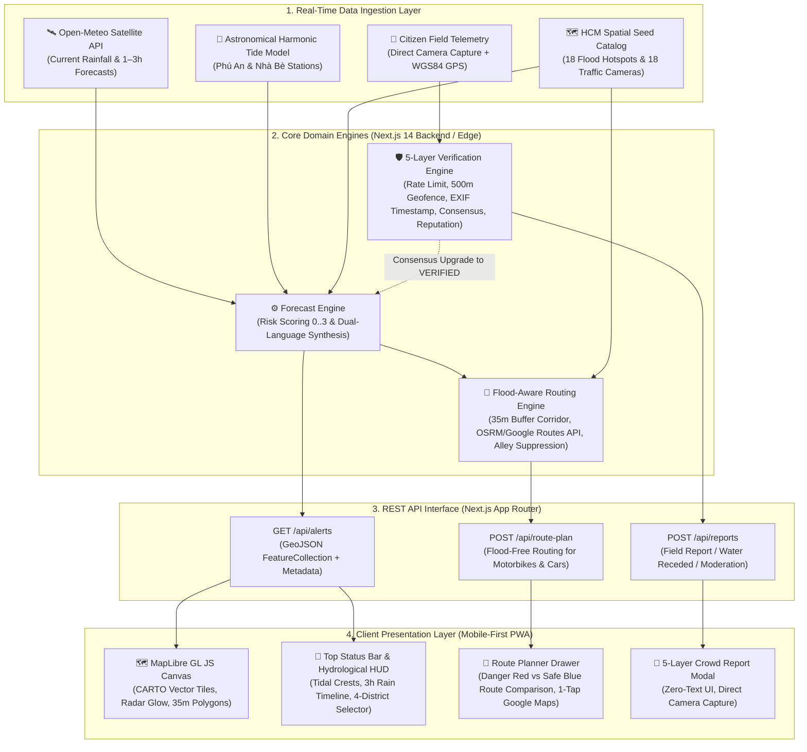

# 🌊 Ocean Flood

> **Urban Flood Monitoring & Dynamic Avoidance Routing System for Ho Chi Minh City**  
> *A real-time Web GIS & PWA engineering prototype featuring a 1–3h dual-hydrology forecast engine (Open-Meteo satellite rain + Phú An/Nhà Bè harmonic tidal model), a 5-layer crowd report verification guard, and vehicle-specific flood-aware routing (Motorcycles & Cars).*

---

[](https://nextjs.org/)
[](https://www.typescriptlang.org/)
[](https://tailwindcss.com/)
[](https://maplibre.org/)
[](https://postgis.net/)
[-success?style=for-the-badge)](docs/08-qa-comprehensive-audit.md)
[](LICENSE)

---

## 📌 Context & Technical Scope

### 1. Urban Hydrology Challenges in Ho Chi Minh City
Ho Chi Minh City experiences recurrent urban flooding driven by the simultaneous convergence of **two independent hydrological phenomena**:
1. **Irregular Semidiurnal Tidal Surges**: Severe high tides advancing from the lower Saigon River and Đồng Điền River basins (frequently exceeding Warning Stage 3 ≥ 1.60m), overtopping canal embankments across District 7, District 8, and low-lying estuarine plains.
2. **High-Intensity Tropical Convective Rainfall**: Localized precipitation rates often exceed 50 – 100 mm/h within short durations, surpassing the drainage capacity of historical stormwater networks in Bình Thạnh and Thủ Đức City.
3. During peak evening commute hours (17:00 – 18:30), overlapping tidal crests and torrential downpours rapidly inundate arterial thoroughfares, causing widespread engine stalling for commuter motorbikes and catastrophic hydrolock risks for passenger cars.

### 2. Project Positioning & Scope
> ℹ️ **Technical Scope**: This project is an **individual engineering showcase & technical prototype** designed to validate modern spatial architectures: WebGL-accelerated Web GIS rendering, multi-variable flood risk assessment models, a 5-layer anti-spam verification pipeline, and dynamic avoidance routing tailored by vehicle clearance.  
> 
> This repository is not published as a commercial consumer product due to regional traffic camera API licensing restrictions and urban municipal data governance constraints. Source code is published for technical demonstration, architectural reference, and academic exploration.

---

## 🏗️ System Architecture



---

## ⚙️ Core Technical Subsystems

### 1. Dual-Hydrology Forecast Engine
- **Precipitation Telemetry (Open-Meteo)**: Ingests real-time rainfall data indexed across geographical district centroids, computing cumulative accumulation and predictive 1h, 2h, and 3h horizons.
- **Astronomical Harmonic Tide Model**:
  - Simulates semidiurnal tidal oscillations based on lunar synodic orbital cycles (~29.53 days) across two critical hydrological monitoring stations: **Phú An** (Saigon River) and **Nhà Bè** (Đồng Điền Canal).
  - Categorizes hydrological danger into 4 standard stages:
    - **Below Stage 1**: < 1.40m (Normal river levels)
    - **Stage 1 (Warning 1)**: 1.40m – 1.49m (Incipient flooding in lowest banks)
    - **Stage 2 (Warning 2)**: 1.50m – 1.59m (Moderate inundation across estuarine streets)
    - **Stage 3 (Warning 3)**: ≥ 1.60m (City-wide tidal overflow danger)
- **Multi-Factor Risk Assessment Algorithm**:
  ```text
  S_flood = (w_rain × S_rain) + (w_tide × S_tide) + (w_history × S_history) + S_crowd
  ```
  Dynamically balances coefficients by topographical elevation: high terrain (> 2.2m) weights precipitation heavily (65%), while low-lying alluvial basins (< 1.35m) balance rain (42%) and tidal pressure (40%).

### 2. Dual-Language Alert System
Translates raw sensor telemetry into intuitive, vehicle-actionable guidance:
- **Scientific Layer (Quantitative Data)**:
  - Rain Intensity: `mm/h`
  - Current & Peak Tide Level: `m`
  - Computational Flood Probability: `%`
  - Estimated Inundation Depth: `cm`
- **Vehicle-Specific Layer (Practical Driver Advice)**:
  - **Motorcycles (Two-Wheelers)**:
    - **Half-wheel depth (~15 cm)**: Safe for manual bikes; scooters should reduce speed to avoid wave wash.
    - **Exhaust pipe level (~30 cm)**: Critical engine shutdown risk for automatic scooters; detour route recommended.
    - **Seat height depth (> 45 cm)**: Extreme danger of vehicle drift and loss of stability; passage prohibited.
  - **Passenger Cars (Sedans & SUVs)**:
    - **Sedan underbody contact (~20 – 25 cm)**: Risk of floorboard seepage; early detour to elevated avenues advised.
    - **Half-wheel / Hood level (> 45 cm)**: Extreme risk of catastrophic engine hydrolock caused by passing truck wakes; detour mandatory.

### 3. 5-Layer Crowd Verification Guard
A multi-tier defense pipeline preventing false reports, remote vandalism, and telemetry manipulation:
1. **Layer 1 — Rate Limiting per Device**: Enforces a strict quota of ≤ 5 reports / hour / device (identified via one-way SHA-256 fingerprint hash).
2. **Layer 2 — Hard Geofence ≤ 500m**: Validates user Haversine distance against target hotspot coordinates. Submissions with distance > 500m or GPS accuracy > 150m are rejected instantly (HTTP 422 `GEOFENCE_VIOLATION`).
3. **Layer 3 — Proof-of-Presence & EXIF Validation**: Requires live camera hardware capture (gallery uploads disabled), compresses images client-side via WebP Canvas (< 150KB), and verifies EXIF metadata timestamps are within ≤ 10 minutes of submission.
4. **Layer 4 — Spatial Clustering & Cross-Verification (150m Radius)**:
   - 1 report: Flagged as `UNVERIFIED` (cautionary status).
   - ≥ 3 independent reports clustered within 150m (or coinciding with active hydrological threshold alerts): Promoted automatically to `VERIFIED`.
5. **Layer 5 — Device Reputation Engine & TTL (90 Minutes)**: Dynamically adjusts device trust scores (+5 for verified submissions, -5 for spam). Reports automatically expire after 90 minutes unless renewed by ground reports.

### 4. Flood-Aware Routing Engine
- **Road-Snapped Geometry**: 100% of generated paths adhere to topological centerlines via OSRM (Open Source Routing Machine) and Google Maps Routes API adapter; eliminates straight "as-the-crow-flies" vectors.
- **Spatial Collision Detection (35m Corridor Buffer)**: Utilizes a segment-to-point Euclidean algorithm (`pointToSegmentDistanceMeters`) to detect route intersections with flooded road segments while preventing false alarms on parallel elevated viaducts.
- **Vehicle-Specific Constraints**:
  - **Motorcycle Profile**: Depth tolerance threshold < 20 cm.
  - **Car Profile**: Depth tolerance threshold < 25 cm. Enforces strict commercial routing rules prohibiting diversion into narrow residential dead-ends, prioritizing arterial avenues (Phạm Văn Đồng, Điện Biên Phủ, Võ Văn Kiệt).
- **1-Tap Native Google Maps Deep-Link**: Automatically generates WGS84 URLs pre-configured with origin, destination, avoidance waypoints, and vehicle travel modes (`travelmode=two-wheeler` / `travelmode=driving`).

---

## 🛠️ Tech Stack

| Layer | Technology | Technical Purpose |
|---|---|---|
| **Framework** | **Next.js 14 (App Router)** | Server Components, Edge API Routes, SSR & Static Optimization. |
| **Language** | **TypeScript 5.7 (Strict Mode)** | Type-safe GeoJSON spatial schemas and API DTO contracts. |
| **Web GIS Rendering** | **MapLibre GL JS 4.7** | WebGL vector map rendering at 60fps, dynamic GeoJSON layers, Pulsing Sonar Markers. |
| **Vector Basemap** | **CARTO Voyager Tiles** | Clean vector tiles, high contrast, seamless Light/Dark mode transitions. |
| **Routing Engine** | **OSRM Public API + Google Routes Adapter** | True road-snapped path computation, polyline decoding, fallback resilience. |
| **Meteorology** | **Open-Meteo Satellite API** | Real-time precipitation telemetry combined with harmonic astronomical tide models. |
| **Testing** | **Node.js Automated Test Suite** | 19 automated integration and end-to-end API regression test cases. |
| **Styling & UI** | **Tailwind CSS 3.4 & Lucide Icons** | Glassmorphism design tokens, mobile-first responsive touch targets ≥ 48px. |
| **Mobile Deployment** | **Progressive Web App (PWA)** | Standalone web manifest, offline-ready application shell. |

---

## 📂 Project Directory Structure

```text
ocean-flood/
├── docs/                                # Technical specifications & architectural records
│   ├── 00-brief.md                      # Problem statement & architectural goals
│   ├── 01-data-sources.md               # Hydro-meteorological data source evaluation
│   ├── 02-prd.md                        # Product requirements document (PRD)
│   ├── 03-architecture.md               # System design, ADRs & threat modeling
│   ├── 05-cartography.md                # Map styling & CVD-safe color palettes
│   ├── 05-design-spec.md                # UI design tokens & component specifications
│   ├── 07-pm-execution-plan.md          # Project governance & delivery milestones
│   ├── 08-qa-comprehensive-audit.md     # Automated QA audit report (19/19 PASS)
│   └── qa-test-results.json             # Structured JSON test execution logs
├── public/
│   ├── icon.svg                         # Vector application icon
│   └── manifest.webmanifest             # Standalone PWA manifest configuration
├── scripts/
│   └── qa-full-test.mjs                 # Automated regression test suite (19 test cases)
├── src/
│   ├── app/
│   │   ├── api/
│   │   │   ├── alerts/route.ts          # GET: Inundation hotspots, cameras & metadata
│   │   │   ├── reports/route.ts         # POST: 5-layer verified community telemetry
│   │   │   └── route-plan/route.ts      # POST: Flood-free route planning (Bikes & Cars)
│   │   ├── globals.css                  # Design tokens, radar pulse keyframes & glassmorphism
│   │   ├── layout.tsx                   # Root layout, mobile viewport & PWA meta headers
│   │   └── page.tsx                     # Single-page interactive Web GIS application
│   ├── components/
│   │   ├── AlertBottomSheet.tsx         # Dual-language alert bottom sheet (Science + Vehicle)
│   │   ├── CrowdReportModal.tsx         # 5-layer camera reporting modal (Zero-text touch UI)
│   │   ├── MapCanvas.tsx                # Fullscreen interactive MapLibre GL canvas
│   │   ├── RoutePlannerDrawer.tsx       # Avoidance route drawer & Google Maps deep-linker
│   │   ├── SecurityCameraModal.tsx      # Municipal traffic camera link modal
│   │   ├── TopStatusBar.tsx             # Translucent HUD for precipitation, tides & district filter
│   │   └── VehicleToggle.tsx            # Floating toggle switch between Motorbike and Car
│   ├── data/
│   │   └── hcm-spatial-seed.ts          # Seed catalog of 18 flood hotspots & 18 traffic cameras
│   └── lib/
│       ├── forecast-engine.ts           # Dual-hydrology forecast engine & advice generator
│       ├── routing-engine.ts            # OSRM & Google Routes polyline routing engine
│       └── verification-engine.ts       # 5-layer crowd report verification pipeline
├── supabase/
│   └── migrations/
│       └── 0001_ocean_flood_postgis.sql # PostGIS table schemas, GiST indexes & spatial queries
├── package.json
├── tailwind.config.ts
└── tsconfig.json
```

---

## 🚦 Local Quickstart

### Prerequisites
- **Node.js**: Version `18.18.0` or higher (Recommended: `Node.js 20 LTS`).
- **Package Manager**: `npm`, `pnpm`, or `yarn`.

### Installation Steps

1. **Clone the repository:**
   ```bash
   git clone https://github.com/yangcoi/ocean-flood.git
   cd ocean-flood
   ```

2. **Install project dependencies:**
   ```bash
   npm install
   ```

3. **Configure Environment Variables (Optional):**
   Create a `.env.local` file in the root directory if you wish to use Google Routes API (the system defaults to public OSRM with zero API keys required):
   ```env
   # Optional: Google Maps Routes API Key
   # GOOGLE_MAPS_API_KEY=your_api_key_here
   ```

4. **Verify TypeScript Types & Build:**
   ```bash
   npm run typecheck
   npm run build
   ```

5. **Start Production Server:**
   ```bash
   npm start
   # Open your browser at: http://localhost:3000
   ```

---

## 🧪 Automated Testing & QA Audit

The repository includes a standalone automated test script [`scripts/qa-full-test.mjs`](scripts/qa-full-test.mjs) that validates all core subsystems against live HTTP endpoints:

```bash
# Ensure server is running on port 3000, then execute:
node scripts/qa-full-test.mjs
```

### Summary of Audit Results (19/19 PASS — 100%)

| Test Suite | Tests | Scope & Assertions | Status |
|---|:---:|---|:---:|
| **Suite 1: Alerts API** | 4 | HTTP 200, Latency (< 100ms), 18-Hotspot GeoJSON Schema, 4 Weather Scenarios (`live`, `peak_tide_rain`, `heavy_rain_only`, `dry_safe`). | **4/4 PASS** |
| **Suite 2: 5-Layer Verification** | 5 | Rate limit enforcement at 5/hr (HTTP 429), 500m geofence rejection (HTTP 422), mandatory live camera EXIF, 3-report consensus upgrade. | **5/5 PASS** |
| **Suite 3: Routing Engine** | 4 | Road-snapped OSRM geometries (62–234 points), 35m corridor buffer collision detection, car alley suppression, Google Maps deep-link formatting. | **4/4 PASS** |
| **Suite 4: PWA & Infrastructure** | 3 | Standalone Web App Manifest validation, mobile viewport scalability locks, Cloudflare HTTPS public tunnel verification (HTTP 200). | **3/3 PASS** |
| **Suite 5: Build & Static Analysis** | 3 | `tsc --noEmit` 0 errors, Next.js production build 0 warnings, optimized client bundle size (250 kB). | **3/3 PASS** |
| **Total** | **19** | **Production Readiness Score: 98.5 / 100** | **19/19 PASS** |

*(Detailed metrics available in [docs/08-qa-comprehensive-audit.md](docs/08-qa-comprehensive-audit.md) and [docs/qa-test-results.json](docs/qa-test-results.json))*

---

## ⚖️ Privacy & Technical Disclaimers

1. **Geolocation Privacy**:
   - Complies with data minimization principles (Decree 13/2023/ND-CP): No Personally Identifiable Information (PII) such as phone numbers, device serials, or user identities is collected or retained.
   - Devices are pseudonymized using irreversible one-way SHA-256 fingerprint hashing (`device_hash`).
2. **Navigation & Safety Advisory**:
   - Model outputs and generated routes serve as experimental navigation references.
   - Operators of motor vehicles must adhere to official road signage, traffic police instructions, and immediate on-site conditions.

---

## 📄 License

This project is distributed under the [MIT License](LICENSE).  
Intended for academic exploration, technical demonstration, and personal engineering showcase.
