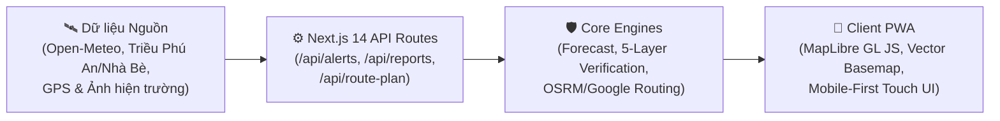

# Ocean Flood

> Bản đồ cảnh báo ngập và gợi ý lộ trình né ngập thời gian thực tại TP.HCM.  
> *Dự án cá nhân (Pet project / Portfolio) thử nghiệm tích hợp Web GIS, mô hình thủy văn đô thị và thuật toán định tuyến tránh ngập.*

[](https://nextjs.org/)
[](https://www.typescriptlang.org/)
[](https://maplibre.org/)
[](https://tailwindcss.com/)
[](docs/08-qa-comprehensive-audit.md)

---

## 📌 Vấn đề & Ý tưởng

TP.HCM thường xuyên ngập nặng do sự kết hợp của 2 yếu tố: **Mưa lớn dông nhiệt** và **Triều cường dâng cao** (sông Sài Gòn & Nhà Bè). Người đi đường (đặc biệt là xe tay ga và ô tô gầm thấp) rất khó biết tuyến nào đang ngập hoặc sắp ngập để chủ động chuyển hướng.

**Ocean Flood** được xây dựng để thử nghiệm giải quyết bài toán này với 3 trọng tâm:
1. Dự báo nguy cơ ngập sớm 1–3h trước khi vào vùng ngập.
2. Cảnh báo theo ngôn ngữ thực tế của phương tiện (ống pô, gầm xe) thay vì chỉ để con số cm khô khan.
3. Tìm lộ trình thay thế né ngập bám sát tim đường thực tế (OSRM/Google Maps), không vẽ đường thẳng "chim bay".

> ⚠️ **Lưu ý**: Đây là **dự án cá nhân / đồ án nghiên cứu kỹ thuật**, không nhằm mục đích thương mại hay phát hành diện rộng (do các rào cản về bản quyền API camera an ninh giao thông và pháp lý đô thị).

---

## 🚀 Tính năng chính

### 1. Dự báo ngập theo Mưa + Triều cường (Open-Meteo + Mô hình triều Phú An/Nhà Bè)
- Lấy lượng mưa thời gian thực và dự báo 3 giờ tới từ Open-Meteo.
- Tính toán mực nước thủy triều theo chu kỳ bán nhật triều tại trạm Phú An (Sông Sài Gòn) và Nhà Bè.
- Phân loại rủi ro 4 cấp độ và hiển thị timeline diễn biến nước dâng/rút trong 3 giờ tới.

### 2. Cảnh báo ngôn ngữ kép (Số liệu + Thực tế loại xe)
- **Số liệu**: Hiển thị vũ lượng (`mm/h`), đỉnh triều (`m`), xác suất ngập (`%`), độ sâu ước tính (`cm`).
- **Thực tế xe máy**: Cảnh báo theo mốc cơ học (nửa bánh ~15cm, ngang ống pô ~30cm dễ chết máy, ngập lút yên >45cm nguy hiểm).
- **Thực tế ô tô**: Cảnh báo theo chiều cao gầm (chạm gầm sedan 20–25cm, ngập nửa bánh dễ dính thủy kích khi gặp sóng xe tải).

### 3. Báo cáo ngập cộng đồng có kiểm duyệt 5 lớp
Để chống báo ảo và spam:
- **Geofence cứng 500m**: Chỉ cho phép người đang đứng cách điểm ngập ≤ 500m gửi báo cáo (GPS lệch > 500m bị chặn ngay).
- **Bắt buộc chụp camera tại chỗ**: Chỉ mở camera trực tiếp, không cho chọn ảnh cũ từ thư viện; kiểm tra EXIF ≤ 10 phút.
- **Giới hạn tần suất**: Tối đa 5 lượt báo cáo / giờ / thiết bị.
- **Xác thực chéo 150m**: Cần tối thiểu 3 người độc lập cùng xác nhận để nâng trạng thái từ *Chưa xác thực* (`UNVERIFIED`) lên *Đã xác thực* (`VERIFIED`).
- **TTL 90 phút**: Báo cáo tự động hết hạn sau 90 phút nếu nước đã rút.

### 4. Gợi ý lộ trình né ngập (Routing Engine)
- Bám sát tim đường OSRM, loại bỏ hoàn toàn hiện tượng vẽ đường thẳng xuyên nhà dân.
- Kiểm tra giao cắt với vùng đệm điểm ngập (Corridor Buffer 35m), không báo động giả khi đi trên cầu vượt hoặc đường song song.
- **Chế độ Ô tô**: Nghiêm cấm dẫn vào hẻm cụt / hẻm nhỏ dân sinh.
- **1-Tap mở Google Maps**: Tự động tạo link chuyển sang app Google Maps chính chủ với điểm né (waypoints) và chế độ xe phù hợp (`two-wheeler` hoặc `driving`).

---

## 🏗️ Kiến trúc hệ thống



---

## 🛠️ Tech Stack

- **Frontend**: Next.js 14 (App Router), React 18, Tailwind CSS, Lucide Icons.
- **Bản đồ / GIS**: MapLibre GL JS, CARTO Voyager Vector Tiles, GeoJSON WGS84.
- **Routing**: OSRM API (fallback Google Routes API adapter).
- **Data & Backend**: In-memory PostGIS-ready store, Open-Meteo API.
- **Testing**: Test suite tự động Node.js (`qa-full-test.mjs`) kiểm thử 19 kịch bản API & Logic.

---

## 📂 Cấu trúc thư mục

```text
├── docs/                      # Tài liệu phân tích (PRD, kiến trúc, kiểm thử)
│   ├── 02-prd.md
│   ├── 03-architecture.md
│   ├── 08-qa-comprehensive-audit.md
│   └── qa-test-results.json
├── public/                    # Assets tĩnh, PWA Manifest
│   └── manifest.webmanifest
├── scripts/
│   └── qa-full-test.mjs       # Script kiểm thử tự động 19 test cases
├── src/
│   ├── app/
│   │   ├── api/alerts/        # GET: Dữ liệu điểm ngập, dự báo 3h, camera TTGT
│   │   ├── api/reports/       # POST: Báo cáo ngập qua 5 lớp kiểm duyệt
│   │   └── api/route-plan/    # POST: Tìm đường né ngập cho xe máy / ô tô
│   ├── components/            # MapCanvas, AlertBottomSheet, RoutePlannerDrawer...
│   ├── data/                  # Seed 18 điểm đen ngập & camera 4 quận TP.HCM
│   └── lib/                   # forecast-engine, verification-engine, routing-engine
└── package.json
```

---

## 💻 Cài đặt & Chạy cục bộ

```bash
# 1. Clone repo
git clone https://github.com/yangcoi/ocean-flood.git
cd ocean-flood

# 2. Cài packages
npm install

# 3. Chạy môi trường dev
npm run dev
# App chạy tại: http://localhost:3000

# 4. Build production
npm run build
npm start

# 5. Chạy bộ kiểm thử tự động (yêu cầu app đang chạy port 3000)
node scripts/qa-full-test.mjs
```

---

## 📄 License

Dự án phát hành dưới giấy phép [MIT License](LICENSE).
Mục đích phục vụ học tập, nghiên cứu cá nhân và phát triển kỹ năng kỹ thuật.
