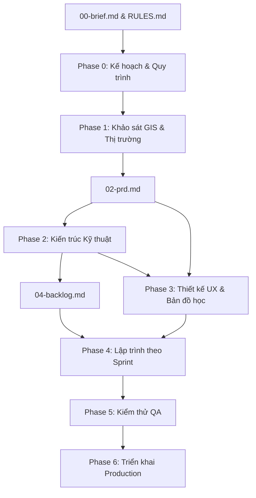

# Ma Trận Điều Phối Agent (Agents Orchestration): HCM Alert Map

**Người phụ trách:** Agents Orchestrator (`agency-agents-orchestrator`)  
**Dựa trên:** `docs/RULES.md`, `docs/00-brief.md`, `docs/00-plan.md`, `docs/00-git-workflow.md`  
**Ngày lập:** 2026-10-12  

---

## 1. Nguyên Tắc Điều Phối & Cơ Chế "Bộ Nhớ Chung"

Trong toàn bộ dự án, **không có agent nào làm việc biệt lập**. Mỗi agent hoạt động như một mắt xích chính xác trong dây chuyền sản xuất:
* **Input (Đọc):** Đọc nghiêm ngặt các tài liệu đầu ra của agent đi trước.
* **Execution (Xử lý):** Chỉ thực hiện đúng phạm vi chuyên môn quy định trong Prompt.
* **Output (Ghi):** Ghi kết quả vào file markdown định trước trong thư mục `docs/` để chuyển giao cho agent tiếp theo.
* **Quality Gates:** Dừng lại tại mỗi điểm kiểm soát (GATE) để Chủ dự án thẩm định và ký duyệt trước khi chuyển Phase.

---

## 2. Bảng Ma Trận Điều Phối Toàn Diện (Orchestration Matrix)

| Phase | Bước | Agent Phụ Trách (Role & Skill) | File Cần Đọc (Input) | File Ghi Kết Quả (Output) | Điều Kiện Qua Cửa (Gate) |
| :--- | :--- | :--- | :--- | :--- | :--- |
| **0. Khởi Động** | 0.1 | **Senior Project Manager** | `docs/RULES.md`, `docs/00-brief.md` | `docs/00-plan.md` | |
| | 0.2 | **Git Workflow Master** | `docs/RULES.md`, `docs/00-plan.md` | `docs/00-git-workflow.md`, `.gitignore` | |
| | 0.3 | **Agents Orchestrator** | `docs/RULES.md`, `docs/00-brief.md`, `docs/00-plan.md`, `docs/00-git-workflow.md` | `docs/00-orchestration.md` | **GATE 0:** Chủ dự án duyệt kế hoạch và ma trận điều phối. |
| **1. Discovery** | 1.1 | **GIS Technical Consultant** | `docs/RULES.md`, `docs/00-brief.md` | `docs/01-data-sources.md` | |
| | 1.2 | **Legal Compliance Checker** | `docs/RULES.md`, `docs/00-brief.md`, `docs/01-data-sources.md` | `docs/01-legal.md` | |
| | 1.3 | **Trend Researcher** | `docs/RULES.md`, `docs/00-brief.md` | `docs/01-market.md` | |
| | 1.4 | **UX Researcher** | `docs/RULES.md`, `docs/00-brief.md`, `docs/01-market.md` | `docs/01-interview-guide.md` | *(Tạm dừng: Phỏng vấn thực tế $\rightarrow$ `01-interview-notes.md`)* |
| | 1.5 | **Feedback Synthesizer** | `docs/RULES.md`, `docs/01-interview-guide.md`, `docs/01-interview-notes.md` | `docs/01-insights.md` | |
| | 1.6 | **GIS Analyst** | `docs/RULES.md`, `docs/00-brief.md`, `docs/01-data-sources.md`, `docs/01-insights.md` | `docs/01-spatial-requirements.md` | |
| | 1.7 | **Product Manager** | Đọc toàn bộ `docs/01-*.md` và `docs/00-brief.md` | `docs/02-prd.md` | **GATE 1:** Duyệt PRD. Bắt buộc xác minh ít nhất 1 nguồn dữ liệu khả thi. |
| **2. Kiến Trúc** | 2.1 | **Software Architect** | `docs/RULES.md`, `docs/02-prd.md`, `docs/01-data-sources.md`, `docs/01-spatial-requirements.md` | `docs/03-architecture.md` | |
| | 2.2 | **Workflow Architect** | `docs/02-prd.md`, `docs/03-architecture.md` | `docs/03-workflows.md` | |
| | 2.3 | **GIS Spatial Data Engineer** | `docs/01-data-sources.md`, `docs/01-spatial-requirements.md`, `docs/03-architecture.md` | `docs/03-data-pipeline.md` | |
| | 2.4 | **Backend Architect** | `docs/03-architecture.md`, `docs/03-workflows.md`, `docs/03-data-pipeline.md` | `docs/03-api.md` | |
| | 2.5 | **Database Optimizer** | `docs/03-data-pipeline.md`, `docs/03-api.md` | `docs/03-db-tuning.md` | |
| | 2.6 | **Security Architect** | `docs/03-architecture.md`, `docs/03-workflows.md`, `docs/03-api.md` | `docs/03-threat-model.md` | |
| | 2.7 | **Privacy Engineer** | `docs/01-legal.md`, `docs/03-workflows.md`, `docs/03-api.md` | `docs/03-privacy.md` | |
| | 2.8 | **Senior PM + Sprint Prioritizer** | Toàn bộ `docs/02-*.md` và `docs/03-*.md` | `docs/04-backlog.md` | **GATE 2:** Duyệt kiến trúc và danh sách công việc theo Sprint. |
| **3. Thiết Kế** | 3.1 | **UX Architect** | `docs/02-prd.md`, `docs/01-insights.md`, `docs/03-api.md` | `docs/05-design-spec.md` (Tokens & Structure) | |
| | 3.2 | **GIS Cartography Designer** | `docs/01-spatial-requirements.md`, `docs/05-design-spec.md` | `docs/05-cartography.md` | |
| | 3.3 | **UI Designer** | `docs/05-design-spec.md`, `docs/05-cartography.md` | `docs/05-design-spec.md` (Screens & Components) | |
| | 3.4 | **Persona Walkthrough Specialist**| `docs/01-insights.md`, `docs/05-design-spec.md` | `docs/05-walkthrough.md` | **GATE 3:** Duyệt thiết kế giao diện và phong cách bản đồ cảnh báo. |
| **4. Build (Dev)** | 4.0 | **GIS Solution Engineer** | `docs/RULES.md`, `docs/03-architecture.md`, `docs/04-backlog.md`, `docs/05-cartography.md` | Prototype Walking Skeleton + `docs/06-sprint-1.md` | |
| | 4.1 | **GIS Spatial Data Engineer** | `docs/03-data-pipeline.md`, task sprint tương ứng | Mã nguồn ETL dữ liệu + `docs/06-sprint-N.md` | |
| | 4.2 | **Backend Architect** | `docs/03-api.md`, `docs/03-db-tuning.md`, task sprint | Mã nguồn API Backend + `docs/06-sprint-N.md` | |
| | 4.3 | **GIS Web GIS Developer** | `docs/05-cartography.md`, `docs/03-api.md`, task sprint | Mã nguồn Map Rendering + `docs/06-sprint-N.md` | |
| | 4.4 | **Frontend Developer** | `docs/05-design-spec.md`, task sprint | Mã nguồn UI App + tích hợp bản đồ | **GATE 4:** Bản đồ chạy thông suốt end-to-end, load < 3s trên 4G. |
| **5. QA** | 5.1 | **GIS QA Engineer & Test Automation** | `docs/02-prd.md`, `docs/05-cartography.md`, toàn bộ code | `docs/07-qa-report.md` | **GATE 5:** Không còn lỗi nghiêm trọng về tọa độ hay hiển thị. |
| **6. Launch** | 6.1 | **DevOps & SRE** | `docs/03-architecture.md`, mã nguồn hoàn thiện | `docs/08-launch.md`, `docs/08-runbook.md` | **GATE 6:** Đưa ứng dụng lên production và sẵn sàng sử dụng. |

---

## 3. Phân Tích Chuỗi Phụ Thuộc (Dependency Chain)

---

## 4. Rủi Ro Dừng Dự Án Lớn Nhất (Kill-Switch Risk)

* **RỦI RO TỬ HUYỆT:** Nguồn dữ liệu thủy văn & ngập lụt tại TP.HCM.
  - Nếu ở **Phase 1 (Task 1.1)**, `GIS Technical Consultant` không tìm được bất kỳ nguồn dữ liệu số hóa nào (API, WMS/WFS, hoặc bảng dữ liệu đo mực nước theo giờ), dự án có nguy cơ bị đình trệ.
  - **Phương án dự phòng bắt buộc (Contingency Plan):** 
    1. Chuyển sang mô hình tĩnh: Tạo bảng dữ liệu điểm ngập lịch sử theo mức triều (dựa trên báo cáo tổng kết ngập lụt TP.HCM hàng năm).
    2. Cập nhật dữ liệu triều tự động theo lịch thủy triều thiên văn công khai (tính toán chu kỳ toán học định kỳ).
    3. Bổ sung cơ chế người dùng báo cáo nhanh tại chỗ.

---

## 5. Quyết Định Đã Chốt
1. Toàn bộ 18 vai trò trong dự án đã được map chính xác với danh sách Agent của The Agency.
2. Thống nhất cơ chế lưu vết qua hệ thống file đánh số thứ tự từ `00` đến `08`.
3. Chỉ tiến hành bước tiếp theo khi file output của bước trước đã được ghi thành công vào thư mục `docs/`.

---

## 6. Câu Hỏi Mở Cho Chủ Dự Án
1. Bạn có muốn kích hoạt ngay **Phase 1 (Discovery)** bắt đầu với **Task 1.1 - GIS Technical Consultant** để khảo sát nguồn dữ liệu TP.HCM không?

---

## 7. Chuyển Giao / Rủi Ro
* **Bàn giao:** Chuyển giao toàn bộ hồ sơ Phase 0 (`00-plan.md`, `00-git-workflow.md`, `00-orchestration.md`) cho Chủ dự án tại **GATE 0**.
