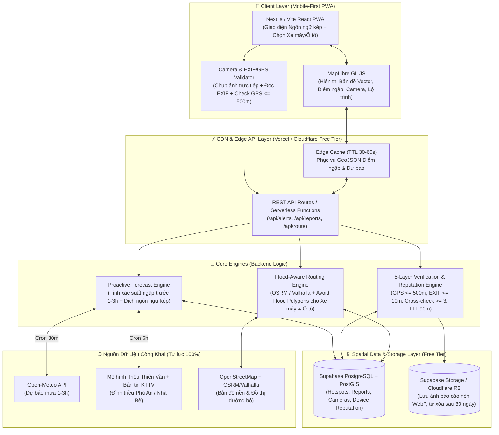

# Kiến Trúc Hệ Thống Tổng Thể (System Architecture): Ocean Flood

**Người phụ trách:** Software Architect (`agency-software-architect`)  
**Dựa trên:** `docs/RULES.md`, `docs/02-prd.md`, `docs/01-data-sources.md`, `docs/01-spatial-requirements.md`  
**Ngày lập:** 2026-10-12  

---

## 1. Sơ Đồ Kiến Trúc Tổng Thể (Component Diagram)

Kiến trúc được thiết kế theo mô hình **Serverless + Edge-Cached Geo-Stack**, đảm bảo **chi phí vận hành = 0đ**, 1 người dễ dàng bảo trì và chịu tải cao khi mưa bão:



---

## 2. Quyết Định Kiến Trúc (Architecture Decision Records — ADR)

### ADR-01: Chọn Stack Frontend & Bản đồ
- **Quyết định:** Sử dụng **Next.js (App Router, TypeScript, Tailwind CSS) + MapLibre GL JS**.
- **Lý do:** Next.js tích hợp sẵn cả giao diện PWA lẫn API Backend trong cùng 1 repository (Monorepo siêu gọn cho 1 người làm), deploy miễn phí 100% lên Vercel. `MapLibre GL JS` render bằng WebGL cực mượt trên điện thoại, hỗ trợ vẽ vùng ngập (Polygon), đường đi (LineString) và điểm camera/báo cáo (GeoJSON) không tốn phí bản quyền.
- **Phương án đã loại:**
  - *Esri ArcGIS JS SDK:* Bundle nặng, tốn phí credit khi mở rộng.
  - *Tách riêng repo React + repo Python/Go:* Tăng gấp đôi công sức cấu hình và deploy cho 1 người.

### ADR-02: Chọn Cơ Sở Dữ Liệu Không Gian (Spatial Database)
- **Quyết định:** **PostgreSQL + PostGIS** trên **Supabase (Free Tier)** kết hợp lưu ảnh báo cáo trên **Supabase Storage** (tự động nén ảnh WebP phía client xuống $< 150\text{KB}$ trước khi tải lên).
- **Lý do:** Cung cấp đầy đủ hàm không gian (`ST_DWithin`, `ST_Intersects`, `ST_Buffer`) để kiểm tra khoảng cách GPS $500\text{m}$, gom cụm báo cáo $150\text{m}$ và kiểm tra giao cắt lộ trình. Dung lượng 500MB DB + 1GB Storage đủ chứa hàng chục nghìn báo cáo (nhờ cơ chế tự xóa ảnh sau 30 ngày).
- **Phương án đã loại:**
  - *MongoDB Atlas:* Hỗ trợ truy vấn hình học phức tạp (cắt đường đi qua vùng đệm ngập) kém chính xác hơn PostGIS.

### ADR-03: Động Cơ Gợi Ý Lộ Trình Tránh Ngập (Flood-Aware Routing cho Xe máy & Ô tô)
- **Quyết định:** Sử dụng **Valhalla (hoặc OSRM) dựa trên dữ liệu OpenStreetMap** kết hợp thuật toán **`exclude_polygons` (vùng cấm đi qua)** và **PostGIS Route Intersection Scoring**.
- **Lý do:**
  1. Khi người dùng nhập Điểm đi $\rightarrow$ Điểm đến và chọn **Xe máy (`motorcycle` / `bicycle-adapted`)** hoặc **Ô tô (`auto`)**, hệ thống lấy danh sách các vùng đệm (`buffer 30m-50m`) của các điểm đang ngập / sắp ngập vượt ngưỡng chịu đựng của loại xe đó ($\ge 20\text{cm}$ cho xe máy, $\ge 25\text{cm}$ cho ô tô).
  2. Hệ thống truyền danh sách `exclude_polygons` vào động cơ định tuyến (Valhalla public/self-hosted API hoặc tính toán đa lộ trình ứng viên rồi lọc qua PostGIS `ST_Intersects`), đồng thời với **Ô tô** thì khóa không cho rẽ vào đường hẻm nhỏ (`service`, `living_street`, `alley`).
- **Phương án đã loại:**
  - *Google Directions API:* Thu phí đắt đỏ và **không cho phép** truyền danh sách polygon ngập tùy chỉnh để ép thuật toán né vùng ngập.

### ADR-04: Động Cơ Dự Báo Sớm 1–3h & Bộ Dịch Ngôn Ngữ Kép (Dual-Language Generator)
- **Quyết định:** Xây dựng **Rule-Based Hydrological Matrix (Ma trận Thủy văn Quy tắc)** chạy tự động mỗi 30 phút.
- **Công thức tính Điểm Nguy Cơ Ngập ($S \in [0, 100]$) cho từng tuyến đường điểm đen:**
  $$S = w_R \cdot f(\text{Rain}_{1\text{h}-3\text{h}}) + w_T \cdot g(\text{Tide}_{\text{Phú An}}) + w_H \cdot \text{HistoryFactor} + w_C \cdot \text{CrowdVerified}$$
  - Từ điểm $S$ và độ trũng địa hình của tuyến đường $\rightarrow$ Suy ra **Độ sâu ngập ước tính ($\text{cm}$)** và tự động sinh ra **2 chuỗi thông báo**:
    1. `scientific_text`: *"Dự báo mưa 45mm/h + Đỉnh triều 1.65m (Phú An) lúc 17:30 — Xác suất ngập 78%, sâu ~30cm"*
    2. `plain_text_motorbike` & `plain_text_car`: *"⚠️ Chiều nay mưa to trùng lúc triều dâng. Đường Nguyễn Xí nguy cơ ngập ngang ống pô xe máy (~30cm), xe tay ga dễ chết máy; ô tô gầm thấp cần tránh!"*

---

## 3. Cấu Trúc Thư Mục Mã Nguồn Dự Kiến (Repository Structure)

```text
ocean-flood/
├── docs/                       # Toàn bộ tài liệu quy hoạch Phase 0 -> Phase 6
├── public/                     # PWA manifest, icons, dữ liệu tĩnh dự phòng
├── src/
│   ├── app/                    # Next.js App Router (Giao diện & API Routes)
│   │   ├── api/
│   │   │   ├── alerts/         # GET danh sách cảnh báo ngập & dự báo 1-3h
│   │   │   ├── reports/        # POST gửi báo cáo + xác nhận chéo + chấm điểm uy tín
│   │   │   ├── route-plan/     # POST tìm lộ trình tránh ngập (Xe máy / Ô tô)
│   │   │   └── cron/           # Job cập nhật mưa Open-Meteo, triều KTTV & dọn TTL
│   │   └── page.tsx            # Màn hình chính bản đồ cảnh báo & tìm đường
│   ├── components/
│   │   ├── map/                # MapLibre canvas, layer điểm ngập, camera, lộ trình
│   │   ├── alert-card/         # Thẻ hiển thị Ngôn ngữ kép (Khoa học + Đời thường)
│   │   ├── report-modal/       # Form chụp ảnh + đọc EXIF + nút mức ngập trực quan
│   │   └── route-planner/      # Thanh tìm đường + nút chuyển đổi Xe máy / Ô tô
│   ├── lib/
│   │   ├── forecast-engine.ts  # Thuật toán dự báo ngập 1-3h & sinh ngôn ngữ kép
│   │   ├── verification.ts     # Kiểm tra 5 lớp (GPS <= 500m, EXIF <= 10m, Cross-check)
│   │   ├── routing-engine.ts   # Tích hợp OSRM/Valhalla + cắt tránh vùng ngập PostGIS
│   │   └── db.ts               # Kết nối Supabase PostGIS
├── supabase/
│   └── migrations/             # SQL khởi tạo bảng PostGIS & Spatial Indexes
└── package.json
```

---

## 4. Quyết Định Đã Chốt
1. Chốt kiến trúc Monorepo **Next.js + TypeScript + MapLibre GL JS + Supabase PostGIS**.
2. Chốt thiết kế 3 động cơ lõi: **Forecast Engine (Dự báo 1–3h + Ngôn ngữ kép)**, **5-Layer Anti-Spam Verification Engine**, và **Vehicle-Specific Flood-Avoidance Routing Engine (Xe máy & Ô tô)**.

## 5. Câu Hỏi Mở Cho Chủ Dự Án
- Sẽ tổng hợp tại **GATE 2** ở cuối Phase 2.

## 6. Chuyển Giao / Rủi Ro
- **Chuyển giao:** Chuyển sang `docs/03-workflows.md` và `docs/03-data-pipeline.md` để đặc tả chi tiết luồng xử lý và cơ sở dữ liệu PostGIS.
