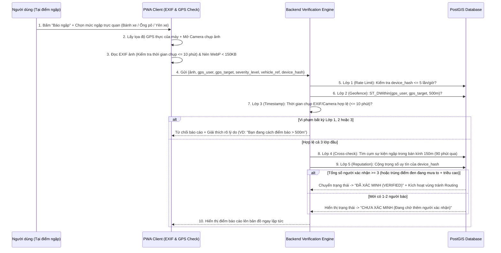

# Đặc Tả Luồng Xử Lý Hệ Thống & Xử Lý Lỗi (System Workflows): Ocean Flood

**Người phụ trách:** Workflow Architect (`agency-workflow-architect`)  
**Dựa trên:** `docs/02-prd.md`, `docs/03-architecture.md`  
**Ngày lập:** 2026-10-12  

---

## 1. Luồng Dự Báo Chủ Động 1–3h & Dịch Ngôn Ngữ Kép (Proactive Forecast Workflow)

- **Trigger:** Cron job chạy định kỳ mỗi 30 phút (hoặc khi có đột biến lượng mưa từ Open-Meteo).
- **Các bước thực thi (Happy Path):**
  1. Gọi `Open-Meteo API` lấy lượng mưa hiện tại và dự báo 1h, 2h, 3h tới cho tâm 4 quận (Bình Thạnh, Q7, Q8, Thủ Đức).
  2. Lấy mực nước triều hiện tại & đỉnh triều trong ngày từ bảng `tide_forecasts` (kết hợp bản tin Đài KTTV & hàm điều hòa thủy triều thiên văn trạm Phú An/Nhà Bè).
  3. Với từng tuyến đường trong danh mục `flood_hotspots`, tính toán Điểm nguy cơ ngập $S \in [0, 100]$ và Độ sâu ước tính ($\text{cm}$).
  4. Bộ tạo ngôn ngữ kép (`DualLanguageFormatter`) sinh 2 bản tin:
     - **Dòng khoa học:** Số liệu mưa ($\text{mm/h}$), đỉnh triều ($\text{m}$), giờ đạt đỉnh, xác suất ($\%$).
     - **Dòng đời thường:** Lời khuyên cụ thể gắn với bộ phận **Xe máy** (bánh xe, ống pô, yên xe) và **Ô tô** (gầm sedan, đèn pha, nguy cơ thủy kích).
  5. Lưu vào bảng `active_alerts` và cập nhật Edge Cache.
- **Xử lý lỗi (Error & Fallback Paths):**
  - *Open-Meteo API lỗi/timeout:* Giữ nguyên bản tin dự báo gần nhất, gắn nhãn `"Dữ liệu mưa cập nhật cách đây X phút (Đang kết nối lại)"`, tuyệt đối không làm trắng bản đồ.
  - *Không lấy được bản tin KTTV mới:* Tự động chuyển sang **Mô hình Thủy triều Thiên văn nội bộ (Astronomical Tide Fallback)** để ước tính mực nước theo pha Mặt Trăng và ghi chú rõ nguồn `"Ước tính theo chu kỳ triều thiên văn"`.

---

## 2. Luồng Người Dùng Báo Cáo Ngập — Kiểm Duyệt 5 Lớp (5-Layer Crowd Report Workflow)

---

## 3. Luồng Gợi Ý Lộ Trình Tránh Ngập Cho Xe Máy & Ô Tô (Flood-Aware Routing Workflow)

- **Trigger:** Người dùng nhập **Điểm đi (A)** $\rightarrow$ **Điểm đến (B)** và chọn loại phương tiện (**Xe máy** hoặc **Ô tô**).
- **Các bước thực thi:**
  1. Truy vấn PostGIS lấy tất cả các vùng ngập đang hoạt động (`VERIFIED` hoặc Dự báo xác suất $\ge 65\%$):
     - Nếu chọn **Xe máy (`motorcycle`)**: Lấy các vùng ngập có độ sâu ước tính $\ge 20\text{cm}$ (nguy cơ ngập ống pô/chết máy). Cho phép đi qua đường cấp `residential` rộng rãi.
     - Nếu chọn **Ô tô (`car`)**: Lấy các vùng ngập có độ sâu ước tính $\ge 25\text{cm}$ (nguy cơ chạm gầm/thủy kích) VÀ loại bỏ các đường nhỏ/hẻm hẹp khỏi đồ thị điều hướng.
  2. Gọi Routing Engine (`Valhalla` / `OSRM`) tính toán lộ trình ngắn nhất ban đầu (`Primary Route`).
  3. Kiểm tra giao cắt không gian `ST_Intersects(primary_route, flood_polygons)`:
     - **Nếu KHÔNG cắt qua vùng ngập:** Trả về lộ trình kèm thông báo xanh: *"✅ Lộ trình an toàn, không đi qua điểm ngập nào."*
     - **Nếu CÓ cắt qua vùng ngập:**
       - Đánh dấu đỏ đoạn đường bị ngập trên bản đồ kèm thẻ cảnh báo kép (Khoa học + Đời thường).
       - Gọi lại Routing Engine với tham số `exclude_polygons` (chứa các vùng đệm ngập) để lấy **Lộ trình thay thế (`Alternative Safe Route`)**.
       - Hiển thị song song 2 đường trên bản đồ: Đường cũ (nét đứt màu đỏ — Cảnh báo ngập) và **Đường gợi ý thay thế (nét liền màu xanh/tím nổi bật)** kèm chênh lệch thời gian/quãng đường (ví dụ: *"+7 phút nhưng tránh được rốn ngập 35cm tại Nguyễn Xí"*).
- **Xử lý trường hợp cực đoan (Mọi lối đi đều ngập):**
  - Nếu cả đường chính lẫn mọi đường vòng đều bị cô lập bởi nước ngập sâu (ví dụ: khu Thảo Điền hoặc Thanh Đa lúc đỉnh triều 1.70m + mưa lớn):
  - Hệ thống **không** ép vẽ đường đi liều lĩnh mà hiển thị cảnh báo khẩn:
    - *Khoa học:* `"Toàn bộ các trục đường ra/vào khu vực hiện có mực nước > 35cm (Đỉnh triều 1.68m)."`
    - *Đời thường:* `"⛔ CẢNH BÁO: Các ngả đường quanh điểm này đều đang ngập sâu quá ống pô/gầm xe. Khuyến nghị hoãn di chuyển ~60–90 phút chờ nước triều rút!"`

---

## 4. Luồng Tự Động Hạ Cấp & Hết Hạn Cảnh Báo (TTL & Auto-Clear Workflow)

- Mỗi điểm ngập cộng đồng có `expires_at = created_at + 90 minutes`.
- Nếu có người dùng khác đi ngang qua (GPS $\le 500\text{m}$) bấm **"Vẫn đang ngập"** $\rightarrow$ Gia hạn thêm 60 phút.
- Nếu có $\ge 2$ người dùng tại chỗ bấm **"Nước đã rút hết"** HOẶC hết 90 phút mà không có mưa/xác nhận mới $\rightarrow$ Chuyển sang trạng thái `CLEARED` (*"Vừa hết ngập"* trong 30 phút) rồi ẩn khỏi bản đồ.

---

## 5. Quyết Định Đã Chốt
1. Mọi luồng lỗi (mất API thời tiết, GPS bị tắt, ảnh không hợp lệ, mọi đường đều ngập) đều có kịch bản xử lý rõ ràng, không bao giờ đưa người dùng vào tình huống nguy hiểm.
2. Phân biệt rõ ràng logic điều hướng giữa **Xe máy** và **Ô tô**.

## 6. Câu Hỏi Mở Cho Chủ Dự Án
- Không có.

## 7. Chuyển Giao / Rủi Ro
- **Chuyển giao:** Chuyển sang `docs/03-data-pipeline.md` và `docs/03-api.md`.
