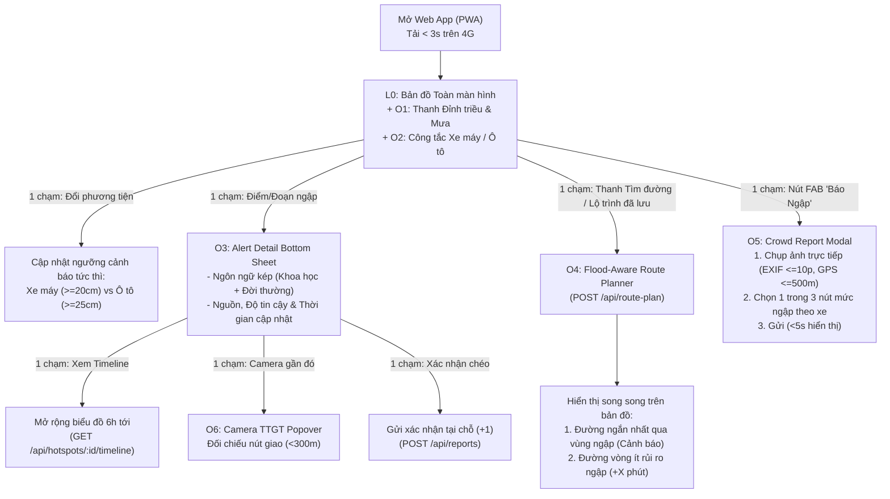

# Đặc Tả Thiết Kế Giao Diện & Trải Nghiệm Người Dùng (UX & Design Specification): Ocean Flood

**Người phụ trách:** UX Architect (`agency-ux-architect`) — Phần 1 | UI Designer (`agency-ui-designer`) — Phần 2  
**Dựa trên:** `docs/RULES.md`, `docs/01-spatial-requirements.md`, `docs/02-prd.md`, `docs/03-api.md`, `docs/05-cartography.md`  
**Chuẩn thiết kế:** LibreUIUX Global Design System (Mobile-first PWA, High-Contrast Outdoor/Rain Readability)  
**Ngày lập:** 2026-10-12  

---

# PHẦN 1: CẤU TRÚC TRẢI NGHIỆM (UX ARCHITECTURE) & DESIGN TOKENS

## 1. Cấu Trúc Thông Tin & Luồng Điều Hướng 1 Chạm (Information Architecture & 1-Tap Flow)

### 1.1 Triết Lý Thiết Kế (Zero-Menu, Single-Canvas Architecture)
Người dùng tại TP.HCM (đặc biệt là người đi xe máy, shipper) thường mở ứng dụng dưới trời mưa, tay ướt, đeo găng tay hoặc dừng xe tấp vào lề đường với thời gian quan sát chỉ **3–5 giây**. Do đó, kiến trúc thông tin loại bỏ hoàn toàn thanh điều hướng nhiều tầng (Multi-page Navigation / Hamburger Menu) và sử dụng **Bản đồ Toàn màn hình Duy nhất (100dvh Full-Viewport Map Canvas)** kết hợp các **Lớp phủ nổi (Floating Overlays & Bottom Sheets)** điều khiển trong vùng ngón cái (*Thumb Zone*).

- **Quyết định kiến trúc UX:** Sử dụng mô hình **Single-Screen Map + Contextual Bottom Sheet** (tương tự Google Maps / Apple Maps tinh gọn) thay vì kiến trúc Multi-Tab (Tab Bản đồ / Tab Danh sách / Tab Tin tức).
- **Lý do & Phương án thay thế đã loại:** Loại bỏ mô hình Multi-Tab vì chuyển tab làm mất ngữ cảnh không gian đang xem và tốn thêm thao tác chạm. Mọi tác vụ cốt lõi đều đạt được trong **$\le 1$ chạm** từ màn hình chính.

### 1.2 Danh Sách Màn Hình & Lớp Phủ (Screens & Overlays Inventory)

| Mã | Tên Lớp / Overlay | Vị trí Hiển thị | Chức năng Cốt lõi & Ràng buộc An toàn (Rule 7) |
| :--- | :--- | :--- | :--- |
| **L0** | **Main Map Canvas (Bản đồ nền & Lớp ngập)** | Toàn màn hình (`100vw x 100dvh`, `z-index: 0`) | Hiển thị bản đồ `MapLibre GL JS` (4 quận: Bình Thạnh, Q7, Q8, Thủ Đức), các đoạn đường ngập (`LineString`/`Polygon`), cụm báo cáo (`Point`) và nút giao Camera TTGT. |
| **O1** | **Top Weather & Tide Status Pill (Thanh trạng thái Mưa & Triều)** | Neo đỉnh màn hình (`top: 12px`, `z-index: 20`) | Hiển thị tóm tắt `tide_station_phu_an` (ví dụ: *"Đỉnh triều 1.68m lúc 17:30 — Báo động 3"*), bộ chọn nhanh 4 Quận và trạng thái độ tươi dữ liệu (`updated_at`). |
| **O2** | **Vehicle Mode Switcher & Quick Controls (Cụm nút nổi bên phải)** | Góc dưới bên phải, trên Bottom Sheet (`z-index: 20`) | Công tắc chuyển nhanh 1 chạm **Xe máy (`motorcycle`) $\leftrightarrow$ Ô tô (`car`)**, nút Định vị GPS (`Locate Me`) và nút chuyển nhanh giao diện Sáng/Tối (`Theme Toggle`). |
| **O3** | **Alert Detail Bottom Sheet (Thẻ chi tiết điểm ngập & Ngôn ngữ kép)** | Trượt từ đáy màn hình (`30% -> 65% dvh`, `z-index: 30`) | Khi chạm vào 1 điểm/đoạn ngập trên bản đồ (`GET /api/alerts`), hiển thị: <br>1. **Dòng 1 (Khoa học):** `scientific_summary` + Xác suất ngập (`flood_probability_pct`).<br>2. **Dòng 2 (Đời thường):** Tự động highlight `plain_motorbike_advice` hoặc `plain_car_advice` theo chế độ xe.<br>3. **Bằng chứng & Độ tin cậy (Rule 7):** Badge xác thực (`VERIFIED` + `confirm_count`), thời điểm cập nhật (`updated_at`), thời gian tự hạ cấp (`expires_at`), nguồn (`source_attribution`).<br>4. **Hành động 1 chạm:** Nút *"Xác nhận còn ngập (+1)"*, nút mở thông tin Camera TTGT gần nhất (`nearby_camera`), và mở biểu đồ Timeline 6h (`GET /api/hotspots/:id/timeline`). |
| **O4** | **Flood-Aware Route Planner Sheet (Bảng tìm đường tránh ngập)** | Drawer mở từ thanh tìm kiếm dưới đáy (`z-index: 35`) | Nhập Điểm đi $\rightarrow$ Điểm đến (hoặc chọn 1 chạm nút *"Nhà $\leftrightarrow$ Công ty"* đã lưu tại `localStorage`), gọi `POST /api/route-plan`. So sánh trực quan **Tuyến ngắn nhất cắt qua vùng ngập (`DANGER_FLOODED` - nét đứt đỏ)** và **Lộ trình gợi ý ít rủi ro ngập (`SAFE_ALTERNATIVE` - nét liền xanh dương)** kèm thời gian chênh lệch (`extra_time_min`). *(Lưu ý: Dùng thuật ngữ "Lộ trình ít rủi ro ngập theo dự báo", không khẳng định tuyệt đối "100% không ngập")*. |
| **O5** | **1-Tap Crowd Report Modal (Hộp thoại Báo ngập hiện trường 5 lớp)** | Nút FAB nổi góc đáy $\rightarrow$ Mở Sheet chuyên biệt (`z-index: 40`) | Luồng báo cáo nhanh trong 3 bước không cần gõ phím:<br>1. Mở Camera chụp ảnh trực tiếp (lấy `exif_captured_at` $\le 10$ phút & `user_gps` $\le 500\text{m}$).<br>2. Chọn **1 trong 3 nút trực quan kích thước lớn** (`WHEEL_15CM` ~15cm / `EXHAUST_30CM` ~30cm / `SEAT_50CM` >50cm).<br>3. Bấm **Gửi báo cáo** (`POST /api/reports`). |
| **O6** | **Traffic Camera Quick Popover (Hộp thông tin Camera TTGT)** | Popover nhỏ trên điểm Camera hoặc trong Sheet `O3` (`z-index: 35`) | Hiển thị tên nút giao (`nearby_camera.name`), khoảng cách từ điểm ngập ($<300\text{m}$) và nút deeplink/hướng dẫn mở ứng dụng TTGT TP.HCM chính통 để người dùng tự đối chiếu. |

### 1.3 Sơ Đồ Luồng Điều Hướng 1 Chạm (1-Tap Navigation Flow)



---

## 2. Thiết Kế Các Trạng Thái Hệ Thống & Ràng Buộc An Toàn (System States & Edge Cases)

Mọi trạng thái hệ thống đều được thiết kế theo nguyên tắc **Không chặn toàn màn hình (Non-blocking UI)** và **Cảnh báo trung thực về độ tin cậy dữ liệu (Rule 7)**.

| Trạng thái | Điều kiện Kích hoạt | Thiết kế Hiển thị & Hành vi Giao diện (UX Behavior) | Thông điệp Hiển thị Mẫu (Microcopy chuẩn Rule 7) |
| :--- | :--- | :--- | :--- |
| **1. Đang tải (Skeleton Loading)** | Khởi chạy ứng dụng lần đầu hoặc đang gọi `GET /api/alerts`, `POST /api/route-plan` ($< 3\text{s}$). | - Hiển thị ngay nền bản đồ Vector Tile từ cache hoặc khung lưới nhẹ.<br>- Thanh `O1` (Top Pill) và khung dưới đáy hiển thị hiệu ứng **Shimmer Skeleton** (`animate-pulse`, nền `slate-200/80` hoặc `slate-800/80`).<br>- Không dùng vòng xoay toàn màn hình (Full-screen blocking spinner) gây cảm giác đơ máy. | *"Đang tải dữ liệu mưa, triều cường và điểm ngập mới nhất..."* |
| **2. Mất mạng (Offline Fallback)** | Thiết bị mất kết nối 4G/Wi-Fi (`navigator.onLine === false`) hoặc request API timeout. | - Service Worker tự động trả về bản chụp `GeoJSON` gần nhất của `/api/alerts` và lộ trình cá nhân đã lưu trong `IndexedDB`/`localStorage`.<br>- Hiển thị **Banner cố định màu Vàng Hổ Phách (`#F59E0B`)** ngay dưới thanh `O1`.<br>- Vô hiệu hóa nút gửi báo cáo mới (`O5`) kèm chú thích rõ ràng, giữ nguyên khả năng xem bản đồ ngoại tuyến. | *"⚠️ **Mất kết nối mạng.** Đang hiển thị dữ liệu lưu tạm từ **[HH:mm]**. Tình trạng ngập thực tế có thể đã thay đổi — vui lòng thận trọng quan sát."* |
| **3. GPS bị tắt hoặc sai số lớn (GPS Disabled / Low Accuracy)** | Người dùng từ chối quyền Geolocation (`PERMISSION_DENIED`), tắt GPS hệ thống, hoặc `accuracy_m > 100m`. | - **Khi xem bản đồ & tìm đường (`L0`, `O4`):** Không khóa ứng dụng. Tự động zoom mặc định vào trung tâm 4 quận trọng điểm (Bình Thạnh, Q7, Q8, Thủ Đức); cho phép chọn Điểm đi/Điểm đến bằng cách chạm ghim trên bản đồ hoặc chọn tên đường.<br>- **Khi bấm Báo ngập (`O5`):** Khóa nút gửi ảnh vì vi phạm lớp kiểm duyệt Geofence $\le 500\text{m}$, hiển thị hộp hướng dẫn bật lại GPS bằng 1 chạm. | *"📍 **Chưa bật định vị GPS.** Bạn vẫn có thể xem bản đồ và chọn điểm tìm đường thủ công. Để gửi Báo cáo ngập tại hiện trường (yêu cầu bán kính ≤500m), vui lòng bật quyền Vị trí."* |
| **4. Dữ liệu cũ (Stale Data $> 90\text{ phút}$)** | Điểm báo cáo cộng đồng quá hạn TTL (`now > expires_at`, tức $> 90\text{ phút}$ không có người xác nhận mới) hoặc dữ liệu trạm mưa/triều (`metadata.updated_at`) cũ hơn 90 phút. | - **Với điểm báo cáo quá 90 phút:** Hạ độ đậm của icon trên bản đồ xuống `opacity: 0.55`, đổi viền sang nét đứt xám-vàng, gắn nhãn `[Dữ liệu cũ >90p]`.<br>- **Trên thẻ `O3`:** Hiển thị hộp cảnh báo nổi bật màu Cam/Xám ngay đầu thẻ để người dân không nhầm lẫn tin cũ là tin vừa mới xảy ra, kèm nút kêu gọi *"Bạn đang ở đây? Cập nhật tình trạng mới"*. | *"🕒 **Cập nhật cách đây hơn 90 phút (lúc [HH:mm]).** Nước có thể đã rút hoặc thay đổi. Thông tin chỉ mang tính tham khảo — chưa có xác nhận mới tại hiện trường."* |

---

## 3. Hệ Thống Design Tokens Chuẩn LibreUIUX (Design System Foundations)

### 3.1 Quyết Định Công Nghệ Giao Diện & Chế Độ Sáng/Tối Thích Ứng Thời Tiết
- **Quyết định lựa chọn:** Áp dụng hệ thống biến CSS (**CSS Custom Properties**) kết hợp **Tailwind CSS Utility Tokens** theo chuẩn **LibreUIUX Global Design System**, hỗ trợ 2 chế độ tương phản cao:
  1. **Outdoor Sunlight Mode (Light Mode - Mặc định ban ngày):** Nền sáng độ tương phản cực cao (`Slate-50` / `White`), chữ đậm sắc nét (`Slate-900`) chống chói dưới nắng gắt trước/sau cơn mưa.
  2. **Night Rain Mode (Dark Mode - Ban đêm / Mưa mù trời):** Nền tối sâu (`Slate-950` `#0B0F19`), giảm chói mắt (anti-glare) khi lái xe ban đêm dưới mưa, làm nổi bật các vệt màu cảnh báo ngập (`Vàng`, `Cam`, `Đỏ`) và lộ trình gợi ý (`Primary #3B82F6`).
- **Lý do & Phương án thay thế đã loại:** Loại bỏ các thư viện UI nặng nề (như Material UI / Ant Design runtime CSS-in-JS) vì làm tăng bundle size và chậm thời gian First Contentful Paint trên mạng 4G yếu lúc mưa bão.

### 3.2 Bảng Màu Cốt Lõi & Ngữ Nghĩa Cảnh Báo Ngập (Color Tokens)

| Nhóm Token | Tên Biến CSS / Token | Giá trị Hex / RGBA | Mục đích Sử dụng & Tương phản WCAG AA/AAA |
| :--- | :--- | :--- | :--- |
| **Brand & Action** | `--color-primary` | `#3B82F6` (Blue 500) | Màu chủ đạo LibreUIUX: Nút hành động chính (Tìm đường), vẽ tuyến đường gợi ý ít rủi ro ngập (`SAFE_ALTERNATIVE`), trạng thái chọn phương tiện. |
| | `--color-primary-hover` | `#2563EB` (Blue 600) | Trạng thái chạm/nhấn (`:active`, `:hover`) của nút Primary, đảm bảo độ tương phản chữ trắng $> 4.5:1$. |
| | `--color-accent` | `#8B5CF6` (Violet 500) | Màu nhấn LibreUIUX: Huy hiệu Dự báo AI/Thủy văn 1–3h tới (`COMBINED`/`FORECAST`), điểm Camera TTGT và biểu đồ Timeline triều cường. |
| **Flood Severity (Chuẩn PRD Mục 4)** | `--flood-level-0-normal` | `#10B981` (Emerald 500) | **Cấp 0 ($0\text{cm}$):** Mặt đường thông thoáng, mưa $<10\text{mm/h}$, triều $<1.40\text{m}$. |
| | `--flood-level-1-watch` | `#F59E0B` (Amber 500) | **Cấp 1 ($10-20\text{cm}$):** Ngập nhẹ xâm xấp bánh xe (~15cm), cảnh báo dữ liệu cũ/offline. |
| | `--flood-level-2-warning` | `#F97316` (Orange 500) | **Cấp 2 ($20-35\text{cm}$):** Ngập nguy hiểm ngang ống pô xe máy / chạm gầm Sedan (~30cm). |
| | `--flood-level-3-critical` | `#EF4444` (Red 500) | **Cấp 3 ($>35-50\text{cm+}$):** Ngập sâu tê liệt lút yên xe / quá đèn pha ô tô, tuyến đường ngập cần tránh (`DANGER_FLOODED`). |
| **Surface & Glassmorphism (Outdoor Light)** | `--surface-canvas-light` | `#F8FAFC` (Slate 50) | Nền bản đồ & khung ứng dụng chế độ Ban ngày ngoài trời nắng. |
| | `--surface-glass-light` | `rgba(255, 255, 255, 0.88)` | Nền thẻ nổi (`O1`, `O3`, `O4`) kết hợp `backdrop-filter: blur(12px)` (`backdrop-blur-md`) và viền `1px solid rgba(15, 23, 42, 0.08)`. |
| | `--text-primary-light` | `#0F172A` (Slate 900) | Chữ chính chế độ sáng (tương phản $> 15:1$ trên nền trắng, đọc rõ dưới nắng). |
| | `--text-secondary-light` | `#475569` (Slate 600) | Chữ phụ (thời gian cập nhật, nguồn dữ liệu). |
| **Surface & Glassmorphism (Night Rain Dark)** | `--surface-canvas-dark` | `#0B0F19` (Deep Slate 950) | Nền bản đồ & ứng dụng chế độ Ban đêm mưa lớn, chống lóa mắt tài xế. |
| | `--surface-glass-dark` | `rgba(15, 23, 42, 0.86)` | Nền thẻ nổi chế độ tối kết hợp `backdrop-filter: blur(12px)` (`backdrop-blur-md`) và viền sáng nhẹ `1px solid rgba(255, 255, 255, 0.14)`. |
| | `--text-primary-dark` | `#F8FAFC` (Slate 50) | Chữ chính chế độ tối (độ tương phản cao, không nhòe khi màn hình dính nước mưa). |
| | `--text-secondary-dark` | `#94A3B8` (Slate 400) | Chữ phụ chế độ tối. |

> [!TIP]
> **Nguyên tắc chống mù màu & đọc dưới mưa (Colorblind & Wet-Screen Safety):** Không bao giờ chỉ dùng màu sắc đơn thuần để phân biệt mức độ ngập. Mọi cấp độ ngập trên bản đồ và thẻ `O3` bắt buộc đi kèm **Biểu tượng trực quan + Con số độ sâu (`~15cm`, `~30cm`, `>45cm`) + Kiểu nét vẽ** (ví dụ: đường ngập vẽ nét đứt đỏ-trắng kèm icon cảnh báo `⚠️`/`⛔`, đường gợi ý vẽ nét liền xanh dương `#3B82F6` có viền trắng bảo vệ `casing`).

### 3.3 Hệ Thống Kiểu Chữ Tiếng Việt (Typography Tokens)
Ưu tiên tuyệt đối khả năng hiển thị dấu tiếng Việt rõ ràng, không cắt dấu ở kích thước nhỏ, đọc lướt trong 2 giây:
- **Font Family chính (`--font-sans`):** `'Be Vietnam Pro', 'Inter', system-ui, -apple-system, sans-serif` (Thiết kế chuyên biệt cho tiếng Việt, độ mở chữ lớn, dễ đọc khi màn hình rung lắc trên giá đỡ điện thoại xe máy).
- **Font Family số liệu (`--font-mono`):** `'JetBrains Mono', ui-monospace, monospace` kết hợp `font-variant-numeric: tabular-nums` (Dùng cho con số mực nước triều `1.68m`, lượng mưa `45mm/h`, độ sâu `~30cm`, khoảng cách `500m`).

| Token Cỡ Chữ | Kích thước (`rem` / `px`) | Độ đậm & Line Height | Ứng dụng cụ thể trên giao diện |
| :--- | :--- | :--- | :--- |
| `--text-hero-metric` | `1.5rem` (`24px`) | `700 (Bold)` / `1.25` | Độ sâu ngập ước tính (`~30cm`), mức đỉnh triều (`1.68m`) và cảnh báo khẩn cấp. |
| `--text-title-lg` | `1.125rem` (`18px`) | `700 (Bold)` / `1.35` | Tên tuyến đường ngập (`Nguyễn Xí - Ung Văn Khiêm`), tiêu đề Bottom Sheet `O3`, `O4`. |
| `--text-body-plain` | `1rem` (`16px`) | `600 (SemiBold)` / `1.5` | **Dòng 2 (Ngôn ngữ đời thường cho Xe máy / Ô tô)** — bắt buộc tối thiểu `16px` để đọc nhanh không cần nheo mắt dưới mưa. |
| `--text-body-sci` | `0.875rem` (`14px`) | `500 (Medium)` / `1.45` | **Dòng 1 (Thông số khoa học)**, tóm tắt lộ trình thay thế (`summary_text`). |
| `--text-meta-trust` | `0.75rem` (`12px`) | `500 (Medium)` / `1.4` | Nhãn nguồn dữ liệu (`source_attribution`), thời điểm cập nhật (`updated_at`), huy hiệu xác thực (`4 người xác nhận`). |

### 3.4 Hệ Thống Khoảng Cách, Bo Góc & Vùng Chạm Tay Ướt (Spacing, Radius & Wet-Finger Touch Targets)

Khi màn hình điện thoại dính nước mưa hoặc người dùng đeo túi chống nước/găng tay, cảm ứng điện dung thường bị lệch tâm chạm từ $4\text{px} - 8\text{px}$. Do đó, chuẩn LibreUIUX cho Ocean Flood áp dụng quy tắc **Wet-Finger Ergonomics**:

| Nhóm Token | Tên Token | Giá trị Chuẩn | Quy tắc Áp dụng Thực tế |
| :--- | :--- | :--- | :--- |
| **Touch Target (Vùng chạm tay ướt)** | `--touch-target-min` | **`48px x 48px`** (`3rem`) | Kích thước tối thiểu bắt buộc cho **mọi nút bấm đơn lẻ**: Nút chuyển Xe máy/Ô tô, nút Định vị GPS, nút Đóng (`X`), điểm bấm Camera trên bản đồ (dùng vùng đệm chạm vô hình `hit-slop` 48x48px dù icon vẽ 28x28px). |
| | `--touch-target-wet-cta` | **`56px` cao** (`3.5rem`) | Áp dụng cho các nút hành động chính dùng dưới mưa: Nút FAB **"Báo Ngập"**, 3 nút chọn mức ngập trực quan (`~15cm`, `~30cm`, `>50cm`), nút **"Tìm đường tránh ngập"**. |
| | `--touch-gap-min` | **`12px`** (`0.75rem`) | Khoảng cách tối thiểu giữa 2 nút tương tác liền kề (đặc biệt là 3 nút chọn mức ngập tại `O5` và nút chuyển `Xe máy | Ô tô`) để chống bấm nhầm tuyệt đối khi tay ướt. |
| **Spacing & Safe Area** | `--space-grid` | Hệ cơ số `4px` (`4, 8, 12, 16, 20, 24, 32px`) | Padding trong thẻ Bottom Sheet tối thiểu `16px` (`p-4`), khoảng cách giữa khối Ngôn ngữ Đời thường và Khoa học là `12px` (`gap-3`). |
| | `--safe-area-bottom` | `max(16px, env(safe-area-inset-bottom))` | Đảm bảo nút dưới đáy không bị che bởi thanh Home Indicator trên iOS/Android. |
| **Glassmorphism & Elevation** | `--glass-blur` | `backdrop-filter: blur(12px)` (`backdrop-blur-md`) | Giúp người dùng vẫn nhìn thấy vệt màu tuyến đường ngập bên dưới lớp thẻ nổi, giữ ngữ cảnh không gian liên tục. |
| | `--radius-sheet` | `20px 20px 0 0` (`rounded-t-2xl`) | Bo góc trên của Bottom Sheet `O3`, `O4`, `O5` tạo cảm giác vuốt kéo mượt mà. |
| | `--radius-pill` | `9999px` (`rounded-full`) | Áp dụng cho thanh trạng thái đỉnh triều `O1`, công tắc `Xe máy / Ô tô` và các huy hiệu độ tin cậy (`VERIFIED`). |

---

# PHẦN 2: ĐẶC TẢ CHI TIẾT MÀN HÌNH & COMPONENTS CHUẨN LIBREUIUX

> [!IMPORTANT]
> **Nguyên tắc Thực thi UI (LibreUIUX Wet-Finger & Safety-First):**
> 1. **Tỷ lệ Hiển thị Bản đồ (`Map Canvas Visibility`):** Ở trạng thái mặc định, `Map Canvas` bắt buộc chiếm **$> 85\%$ diện tích màn hình mobile** (`100vw x 100dvh`), các điều khiển nổi sử dụng cấu trúc *Compact Pill* gọn gàng, không che khuất vùng trung tâm bản đồ.
> 2. **Trách nhiệm An toàn Thông tin (Rule 7):** Tuyệt đối không dùng các cụm từ khẳng định tuyệt đối (*"Đường an toàn 100%"*, *"Chắc chắn không ngập"*). Mọi thẻ thông tin đều phải hiển thị cặp **Độ tin cậy + Thời điểm cập nhật + Nguồn dữ liệu**.
> 3. **Quyết định Kiến trúc Component (Rule 9):** Sử dụng **Headless UI Primitives (Vaul / Radix Drawer nhẹ) + Tailwind CSS Utility Classes** thay vì xây dựng Modal/Popover truyền thống ở giữa màn hình. *Lý do:* Giữ toàn bộ thao tác trong vùng ngón cái (*Bottom Thumb Zone*) khi cầm điện thoại bằng 1 tay trên xe máy và cho phép nhìn xuyên suốt lớp bản đồ ngập phía trên. *Phương án đã loại:* Full-screen Modal hoặc Center Dialog (che khuất bản đồ và khó với tay bấm nút đóng).

---

## 4. Màn Hình Chính Bản Đồ & Cụm Điều Khiển Nổi (`L0` + `O1` + `O2` + FAB)

### 4.1 Bố Cục Không Gian Màn Hình Chính (Mobile Viewport Layout `390x844px` chuẩn)

```text
+-------------------------------------------------------------------+
| [O1: Top Status Bar - Compact Glass Pill]          (z-index: 20)  |
| 🌧️ Mưa 42mm/h • 🌊 Triều Phú An 1.68m (BĐ3) • 🕒 2p trước  [Quận▾]|
+-------------------------------------------------------------------+
|                                                                   |
|                                                                   |
|                   [L0: MAIN MAP CANVAS (>85%)]                    |
|              (MapLibre GL JS - CVD-Safe Symbology)                |
|                                                                   |
|         ━━━ Tuyến ngập Cấp 2-3 (Nét liền + Casing trắng)          |
|         ┈┈┈ Dự báo ngập 1-3h (Nét đứt + Vùng đệm sọc chéo)        |
|         [⚠️ ~30cm ✓4]              [📹 Cam TTGT 120m]             |
|                                                                   |
|                                                   +-------------+ |
|                                                   | [O2: Toggle]| |
|                                                   |  🏍️ Xe máy  | |
|                                                   |  (Đang chọn)| |
|                                                   | ----------- | |
|                                                   |  🚗 Ô tô    | |
|                                                   +-------------+ |
|                                                   |  [🎯 GPS]   | |
|                                                   |  [🌗 Sáng]  | |
|                                                   +-------------+ |
|                                                                   |
| +-------------------------------------------+   +---------------+ |
| | 🔍 Tìm lộ trình tránh ngập...             |   | 🚨 BÁO NGẬP   | |
| | [🏠 Đi làm hằng ngày: Q7 ➔ Bình Thạnh]    |   |   (FAB ≥56px) | |
| +-------------------------------------------+   +---------------+ |
+-------------------------------------------------------------------+
```

### 4.2 Đặc Tả Chi Tiết Từng Thành Phần Trên Màn Hình Chính

#### A. Lớp Bản Đồ Nền & Không Gian Hiển Thị (`L0: Main Map Canvas`)
- **Kích thước & Tỷ lệ:** `w-screen h-dvh relative overflow-hidden`. Tổng diện tích các phần tử nổi (`O1`, `O2`, Search Pill, FAB) chiếm **$< 14\%$ diện tích màn hình**, đảm bảo **$> 86\%$ diện tích** dành trọn cho bản đồ ngập.
- **Đồng bộ Cartography (`docs/05-cartography.md`):**
  - Sử dụng nền `Desaturated Muted Basemap` (`#F1F5F9` Light / `#0B0F19` Dark).
  - Các điểm báo cáo và tuyến ngập render theo đúng phân cấp Zoom 11–18 và thứ tự xếp lớp `Z-Index` từ 1 đến 11 đã chốt.
  - Vùng đệm chạm vô hình (*Hit-slop*) quanh các Marker điểm ngập và Camera TTGT tối thiểu `48x48px`.

#### B. Thanh Trạng Thái Mưa & Đỉnh Triều Phú An (`O1: Top Status Bar`)
- **Vị trí & Kích thước:** Neo sát mép trên `fixed top-3 inset-x-3 z-20`, chiều cao thu gọn `min-h-[48px] max-h-[56px]`, bo tròn `rounded-2xl`, nền kính mờ `backdrop-blur-md bg-white/88 dark:bg-slate-900/86 border border-slate-900/10 dark:border-white/15 shadow-lg px-3.5 py-2`.
- **Cấu trúc Nội dung 3 Khối (Đọc trong 2 giây):**
  1. **Chỉ số Mưa & Triều Phú An (Monospace Badge):**
     - Hiển thị: `🌧️ 42mm/h` | `🌊 Phú An: 1.68m (BĐ3 - 17:30)`.
     - Kiểu chữ: `font-mono text-xs font-semibold tabular-nums`. Tự động đổi màu chấm trạng thái theo ngưỡng triều cường (`#10B981` $<1.4\text{m}$, `#F59E0B` $1.4-1.5\text{m}$, `#F97316` $1.5-1.6\text{m}$, `#EF4444` $>1.6\text{m}$ Báo động 3).
  2. **Nhãn Độ tươi & Nguồn dữ liệu (Rule 7):**
     - Dòng phụ nhỏ ngay bên dưới: `Nguồn: KTTV Nam Bộ & Open-Meteo • Cập nhật 2p trước`.
  3. **Nút Chọn Nhanh 4 Quận Trọng Điểm (`District Quick Jump`):**
     - Pill nhỏ bên phải `min-h-[36px] px-2.5 rounded-full bg-slate-100 dark:bg-slate-800 text-xs font-semibold`: cho phép pan/zoom nhanh 1 chạm tới **Bình Thạnh, Quận 7, Quận 8, TP. Thủ Đức**.

#### C. Công Tắc Nổi Chuyển Đổi Phương Tiện (`O2: Floating Vehicle Toggle`)
- **Vị trí:** `fixed right-3 bottom-28 z-20 flex flex-col gap-3`.
- **Thiết kế Công tắc Kép (`🏍️ Xe máy` vs `🚗 Ô tô`):**
  - Container dạng viên thuốc dọc (`rounded-2xl p-1 bg-white/90 dark:bg-slate-900/90 backdrop-blur-md shadow-xl border border-slate-200 dark:border-slate-700`).
  - Mỗi nút chọn phương tiện có kích thước vùng chạm chuẩn tay ướt: **`w-14 h-12` (`56px x 48px`)**, khoảng cách phân tách `gap-1.5` (`6px` + viền ngăn).
  - **Trạng thái Đang chọn (Active):** Nền `--color-primary` (`#3B82F6`), chữ và icon màu trắng `#FFFFFF`, viền sáng `ring-2 ring-blue-400/50`, hiển thị nhãn phụ cực ngắn:
    - `🏍️ Xe máy` *(Ngưỡng cảnh báo $\ge 20\text{cm}$ — Ống pô)*
    - `🚗 Ô tô` *(Ngưỡng cảnh báo $\ge 25\text{cm}$ — Gầm Sedan)*
  - **Hành vi Tức thì (Zero-Latency Reactivity):** Khi người dùng bấm đổi giữa `🏍️ Xe máy` và `🚗 Ô tô`, toàn bộ bản đồ và thẻ cảnh báo tự động cập nhật lại mức độ nguy hiểm và lời khuyên tương ứng mà không cần tải lại trang.

#### D. Nút Nổi Báo Ngập Nhanh (`Emergency Crowd Report FAB`)
- **Vị trí:** Góc dưới bên phải `fixed right-3 bottom-4 z-25` (nằm ngang hàng với thanh kích hoạt Tìm đường ở góc dưới bên trái).
- **Kích thước Chuẩn Tay Ướt:** Tối thiểu **`h-14 min-w-[140px] px-4` (`cao 56px`, vùng chạm $\ge 56\times 56\text{px}$)**, bo tròn `rounded-full`.
- **Màu sắc & Tương phản:** Nền Cam-Đỏ Khẩn Cấp (`bg-gradient-to-r from-orange-600 to-red-600 hover:from-orange-500 hover:to-red-500 text-white font-bold shadow-xl shadow-red-600/30 border-2 border-white/80`).
- **Nội dung nút:** Icon máy ảnh lớn kèm tia chớp `📸 Báo ngập` (`text-base font-bold tracking-tight`).

---

## 5. Component Thẻ Cảnh Báo Ngôn Ngữ Kép (`O3: Dual-Language Alert Bottom Sheet`)

Khi người dùng chạm vào một tuyến đường ngập hoặc cụm điểm báo cáo trên bản đồ, **Bottom Sheet `O3`** trượt lên từ đáy màn hình (chiếm `38% dvh` ở chế độ xem tóm tắt *Peek* và kéo lên `72% dvh` khi mở rộng xem *Timeline & Camera*).

### 5.1 Wireframe Cấu Trúc Thẻ Cảnh Báo Ngôn Ngữ Kép

```text
+-------------------------------------------------------------------+
|                        [ ━━━ Thanh kéo ]                          |
| [⛔ CẤP 3: NGẬP SÂU]  [✓ Đã xác minh • 4 người báo]   [✕ Đóng 48px]|
| Đường Nguyễn Hữu Cảnh (Đoạn cầu vượt ➔ Hẻm 113), Bình Thạnh       |
| 🕒 Cập nhật: 4 phút trước (17:26) • Tự hạ cấp sau: 86 phút        |
+-------------------------------------------------------------------+
| [DÒNG 1 - KHOA HỌC (Monospace Badge Grid)]                        |
| +---------------+ +---------------+ +---------------+ +---------+ |
| | 🌧️ Mưa: 48mm/h| | 🌊 Triều:1.68m| | 📊 Xác suất:85%| | 📏 ~35cm| |
| +---------------+ +---------------+ +---------------+ +---------+ |
+-------------------------------------------------------------------+
| [DÒNG 2 - ĐỜI THƯỜNG (Highlight tự động theo xe đang chọn)]       |
| +---------------------------------------------------------------+ |
| | 🏍️ ĐANG CHỌN XE MÁY (Highlighted Card - Viền Cam/Đỏ đậm):     | |
| | "Nước ngập quá ống pô và sàn để chân (~35cm). Nguy cơ chết    | |
| |  máy rất cao do sóng nước từ xe lớn — Khuyến cáo không đi qua"| |
| +---------------------------------------------------------------+ |
| | 🚗 Với Ô tô (Chữ mờ tham khảo): Nước chạm gầm Sedan / mép     | |
| |    dưới đèn pha. Nguy cơ thủy kích nếu đi nhanh tạo sóng.     | |
| +---------------------------------------------------------------+ |
+-------------------------------------------------------------------+
| 📡 Nguồn: Cộng đồng (4 ảnh hiện trường) + Trạm triều Phú An KTTV  |
+-------------------------------------------------------------------+
| [KHUNG GIỜ HAY NGẬP & DỰ BÁO 6H TỚI (Mini Timeline)]              |
| 16h [🟨15cm] ➔ 17h [🟧30cm] ➔ 18h [🟥35cm Đỉnh] ➔ 19h [🟨15cm]    |
| 💡 Thường ngập khi mưa >30mm/h trùng đỉnh triều (16:30 – 19:00)   |
+-------------------------------------------------------------------+
| [👍 Vẫn đang ngập (+1)] (Cao 52px) | [📹 Cam TTGT (120m)] (52px)  |
+-------------------------------------------------------------------+
```

### 5.2 Đặc Tả Chi Tiết Các Khối Trong Thẻ `O3`

1. **Header & Huy Hiệu Xác Thực Đa Nguồn (Rule 7 Compliance):**
   - **Huy hiệu Trạng thái Xác thực (`Verification Badge`):**
     - Nếu `status === 'VERIFIED'`: Nền Xanh Dương Đậm `bg-blue-600 text-white px-2.5 py-1 rounded-full text-xs font-bold` hiển thị **`✓ Đã xác minh • 4 người báo`** (kèm icon ảnh chụp).
     - Nếu `status === 'UNVERIFIED'`: Nền Vàng Hổ Phách `bg-amber-500/20 text-amber-700 dark:text-amber-300 border border-amber-500/40` hiển thị **`? Chờ xác minh • 1/3 người báo`**.
     - Nếu `status === 'FORECAST'`: Nền Tím Accent `bg-violet-600 text-white` hiển thị **`🕒 Dự báo trước 2h (Mô hình Mưa + Triều)`**.
   - **Dòng Thời gian & Nguồn dữ liệu bắt buộc:** Hiển thị rõ `updated_at` (*"Cập nhật 4 phút trước"*), `expires_at` (*"Tự hạ cấp sau 86 phút nếu không có báo cáo mới"*), và `source_attribution` (*"Nguồn: Cộng đồng xác nhận chéo & Trạm Phú An"*).

2. **Dòng 1 — Thông Số Khoa Học (`Scientific Metrics Strip`):**
   - Sử dụng lưới 4 ô `grid grid-cols-4 gap-1.5 p-2 rounded-xl bg-slate-100 dark:bg-slate-800/90 border border-slate-200 dark:border-slate-700`.
   - Font chữ bắt buộc: `--font-mono` (`JetBrains Mono`, `tabular-nums`, `13px–14px Medium`), hiển thị 4 chỉ số chuẩn hóa:
     - **Lượng mưa:** `🌧️ {rainfall_mm_h} mm/h`
     - **Mực nước triều:** `🌊 {tide_level_m} m`
     - **Xác suất ngập:** `📊 {flood_probability_pct}%`
     - **Độ sâu ước tính:** `📏 ~{estimated_depth_cm} cm` (Tô màu nền ô này theo màu Cấp ngập 1–3).

3. **Dòng 2 — Ngôn Ngữ Đời Thường Tự Động Hóa Theo Loại Xe (`Vehicle-Adaptive Plain Advice`):**
   - **Quy chuẩn Typography:** Chữ to rõ **`16px–18px SemiBold` (`text-base sm:text-lg font-semibold leading-snug`)**, độ tương phản đạt chuẩn AAA ($> 7:1$).
   - **Cơ chế Highlight Thông minh theo `vehicle_type` đang chọn ở `O2`:**
     - **Khi đang chọn `🏍️ Xe máy`:** Khối lời khuyên Xe máy được đóng khung nổi bật (`p-3.5 rounded-xl bg-orange-500/15 dark:bg-orange-500/20 border-l-4 border-orange-500 text-slate-900 dark:text-white`), đối chiếu trực tiếp mực nước với **bánh xe (~15cm) / ống pô (~30cm) / yên xe (>45cm)**. Khối lời khuyên Ô tô thu nhỏ phía dưới (`text-xs text-slate-500`) để tham khảo.
     - **Khi đang chọn `🚗 Ô tô`:** Tự động đảo khối lời khuyên Ô tô lên vị trí nổi bật chính, đối chiếu trực tiếp với **nửa bánh xe / chạm sàn gầm Sedan (~25-30cm) / mép đèn pha & nguy cơ thủy kích (>40cm)**.

4. **Khung Giờ Hay Ngập & Timeline Dự Báo 6 Giờ (`Hotspot Timeline & Historical Pattern`):**
   - Biểu đồ thanh ngang 6 mốc giờ tiếp theo (`GET /api/hotspots/:id/timeline`), mỗi mốc giờ hiển thị cột màu Cấp 0–3, độ sâu ước tính (`cm`) và nhãn giờ (`16:00`, `17:00`...).
   - Dòng tóm tắt quy luật điểm đen lịch sử (`historical_pattern_note`): Ví dụ *"Điểm trũng lịch sử: Thường ngập 25–35cm khi mưa >30mm/h kết hợp triều cường Phú An >1.50m (khung giờ 16:30–19:00)"*.

5. **Thanh Hành Động Dưới Đáy Thẻ (`Bottom Action Bar`):**
   - Gồm 2 nút lớn chiều cao `52px` (`min-h-[52px]`), khoảng cách `gap-3` (`12px`):
     - **Nút 1 (Xác nhận chéo 1 chạm):** `👍 Vẫn đang ngập (+1)` — cho phép người đang đi ngang qua xác nhận nhanh để gia hạn TTL thêm 90 phút mà không cần tạo báo cáo mới từ đầu.
     - **Nút 2 (Mở Camera TTGT gần nhất):** `📹 Xem Cam TTGT ({distance_m}m)` — mở Popover `O6` hiển thị tên nút giao camera (ví dụ: *Cam Cầu vượt Nguyễn Hữu Cảnh - 120m*) và liên kết đối chiếu trực tiếp.

---

## 6. Component Tìm Lộ Trình Tránh Ngập (`O4: Flood-Aware Route Planner`)

### 6.1 Wireframe Giao Diện Tìm Đường & Thẻ So Sánh Trực Quan

```text
+-------------------------------------------------------------------+
| [O4: FLOOD-AWARE ROUTE PLANNER]                    [✕ Đóng 48px]  |
| +---------------------------------------------------------------+ |
| | 🟢 Điểm đi:  [ Vị trí hiện tại của bạn (GPS ±12m)          ]  | |
| | 🔴 Điểm đến: [ Ngã tư Hàng Xanh, Bình Thạnh                ]  | |
| +---------------------------------------------------------------+ |
| | Phương tiện: [ 🏍️ Xe máy (Tránh ngập ≥20cm) ] [ 🚗 Ô tô ]     | |
| | [⭐ Lưu làm "Lộ trình đi làm hằng ngày" (Lưu trên máy)]       | |
| +---------------------------------------------------------------+ |
|                                                                   |
| SO SÁNH 2 LỘ TRÌNH (Dữ liệu cập nhật 2 phút trước):               |
| +---------------------------------------------------------------+ |
| | ✅ KHUYẾN NGHỊ: LỘ TRÌNH THAY THẾ ÍT RỦI RO NGẬP   [Đang chọn]| |
| | ⏱️ 22 phút (+4 phút) • 6.8 km • Qua Điện Biên Phủ - Xô Viết   | |
| | 🛡️ Tránh được 2 điểm ngập sâu • Mực nước dự kiến trên tuyến   | |
| |    thấp (<10cm, xâm xấp mặt đường)                            | |
| | 📊 Độ tin cậy: Cao (85%) • Nguồn: Cộng đồng & KTTV            | |
| +---------------------------------------------------------------+ |
| +---------------------------------------------------------------+ |
| | ⚠️ ĐƯỜNG NGẮN NHẤT (CẮT QUA ĐIỂM NGẬP ~35CM)      [Không chọn]| |
| | ⏱️ 18 phút (Nhanh hơn 4p nhưng RỦI RO CAO) • 5.4 km           | |
| | ⛔ Đi qua Nguyễn Hữu Cảnh: Đang ngập ~35cm (Ngập quá ống pô   | |
| |    xe máy / Chạm gầm Sedan — 4 người vừa xác nhận)            | |
| +---------------------------------------------------------------+ |
| ℹ️ Lưu ý: Lộ trình gợi ý dựa trên dữ liệu tại thời điểm tra cứu.  |
|    Mực nước thực tế có thể thay đổi nhanh, vui lòng quan sát kỹ.  |
+-------------------------------------------------------------------+
```

### 6.2 Đặc Tả Chi Tiết Component `O4`

1. **Khối Nhập Điểm Đi $\rightarrow$ Điểm Đến & Công Tắc Phương Tiện Đồng Bộ:**
   - **Ô nhập địa điểm:** 2 dòng có nút đảo chiều nhanh (`⇅`, vùng chạm `48x48px`). Hỗ trợ chọn nhanh *"Vị trí hiện tại (GPS)"*, chạm trực tiếp lên bản đồ (*Pin on Map*) khi tắt GPS, hoặc tìm kiếm tên đường trong 4 quận.
   - **Segmented Control (`🏍️ Xe máy` | `🚗 Ô tô`):** Đồng bộ 2 chiều với nút nổi `O2`.
     - Khi chọn **`🏍️ Xe máy`:** Thuật toán định tuyến (`POST /api/route-plan`) né các đoạn ngập $\ge 20\text{cm}$, cho phép gợi ý đi vòng qua đường nhánh/hẻm thông lớn (`residential` cao ráo) và vẽ tuyến màu **Xanh Dương Điện Tử (`#0284C7`)**.
     - Khi chọn **`🚗 Ô tô`:** Thuật toán khóa chặt không cho rẽ vào hẻm nhỏ (chỉ đi `primary`, `secondary`, `tertiary`), né các đoạn ngập $\ge 25\text{cm}$ và vẽ tuyến màu **Xanh Chàm Đậm (`#2563EB`)**.

2. **Thẻ So Sánh Trực Quan Kép (`Side-by-Side / Stacked Route Comparison Cards`):**
   - Hiển thị song song 2 thẻ để người dùng hiểu rõ **tại sao nên đi đường vòng**:
     - **Thẻ 1 — Lộ trình thay thế ít rủi ro ngập (`SAFE_ALTERNATIVE`):** Viền Xanh Dương `--color-primary` (`border-2 border-blue-500 bg-blue-500/10`), nổi bật nhãn **`+Y phút`** (ví dụ: `+4 phút`) đổi lấy việc tránh được đoạn ngập sâu. *(Tuân thủ Rule 7: Sử dụng đúng cụm từ "Lộ trình thay thế ít rủi ro ngập", tuyệt đối không viết "Lộ trình an toàn 100%")*.
     - **Thẻ 2 — Đường ngắn nhất cắt qua điểm ngập (`DANGER_FLOODED`):** Viền nét đứt Đỏ-Cam (`border border-dashed border-red-500/70 bg-red-500/5`), ghi rõ tên đoạn ngập phải cắt qua, độ sâu ước tính **`X cm`** (ví dụ: *"Cắt qua điểm ngập ~35cm tại Nguyễn Hữu Cảnh"*) và hậu quả đời thường (*"Ngập ống pô / Chạm gầm"*).

3. **Tính Năng Lưu "Lộ Trình Đi Làm Hằng Ngày" (`Saved Daily Commute`):**
   - Nút bấm `⭐ Lưu "Lộ trình đi làm hằng ngày"` (`min-h-[48px] w-full rounded-xl border border-blue-500/40 bg-blue-500/10 text-blue-600 dark:text-blue-400 font-semibold`).
   - Lưu trực tiếp cặp tọa độ `{origin, destination, vehicle_type, label: "Đi làm hằng ngày"}` vào `localStorage` của trình duyệt (không bắt buộc đăng nhập tài khoản ở phạm vi MVP — Rule 8).
   - Ngay khi mở ứng dụng vào chiều mưa hôm sau, một nút Pill **`🏠➔🏢 Kiểm tra lộ trình đi làm (1 chạm)`** xuất hiện ngay cạnh thanh tìm kiếm để kiểm tra ngập toàn tuyến chỉ trong **1 giây**.

---

## 7. Component Modal Báo Ngập Kiểm Soát 5 Lớp (`O5: 5-Layer Verified Crowd Report Modal`)

Component này được thiết kế đặc biệt cho người dân đang đứng ngoài đường mưa: **Không có bất kỳ ô nhập văn bản (Text Input) nào**, hoàn thành toàn bộ trong **3 bước chạm lớn ($< 10\text{ giây}$)** và tích hợp trực quan **Hệ thống Kiểm soát Chống Tin Giả 5 Lớp** của PRD.

### 7.1 Wireframe Luồng 3 Bước Báo Ngập Tại Hiện Trường

```text
+-------------------------------------------------------------------+
| 🚨 BÁO NGẬP TẠI HIỆN TRƯỜNG (Kiểm chứng 5 lớp)     [✕ Đóng 48px]  |
+-------------------------------------------------------------------+
| BƯỚC 1: CHỤP ẢNH HIỆN TRƯỜNG & KIỂM TRA VỊ TRÍ TỰ ĐỘNG           |
| +---------------------------------------------------------------+ |
| |      [ 📷 KHUNG CAMERA TRỰC TIẾP / ẢNH VỪA CHỤP (16:9) ]      | |
| |                                                               | |
| |  [✓ Lớp 1 - GPS: Cách điểm ngập 45m (Hợp lệ ≤500m)]           | |
| |  [✓ Lớp 2 - EXIF: Ảnh chụp trực tiếp 10 giây trước (≤10 phút)]| |
| +---------------------------------------------------------------+ |
|                                                                   |
| BƯỚC 2: CHỌN MỨC NGẬP QUAN SÁT ĐƯỢC (Nút lớn ≥64px cho tay ướt)   |
| +-------------------------------+ +-----------------------------+ |
| | 🛞 NGẬP BÁNH XE (~15cm)       | | ⚠️ NGẬP ỐNG PÔ / GẦM (~30cm)| |
| | Xâm xấp mặt đường, đi chậm    | | Xe máy dễ chết máy, né gầm  | |
| | [Min-height: 68px - Vàng]     | | [Min-height: 68px - Cam]    | |
| +-------------------------------+ +-----------------------------+ |
| +-------------------------------+ +-----------------------------+ |
| | ⛔ QUÁ YÊN / NẮP CAPO (>45cm) | | ✅ NƯỚC ĐÃ RÚT HẾT (0cm)    | |
| | Ngập sâu tê liệt, cấm đi vào  | | Mặt đường đã thông thoáng   | |
| | [Min-height: 68px - Đỏ]       | | [Min-height: 68px - Xanh]   | |
| +-------------------------------+ +-----------------------------+ |
|                                                                   |
| BƯỚC 3: ĐỊA CHỈ TỰ ĐỘNG & XÁC NHẬN GỬI 1 CHẠM                     |
| 📍 Vị trí tự động: ~280 Nguyễn Hữu Cảnh, P.22, Q. Bình Thạnh      |
| 🛡️ Lớp 3-5: Tự động gom cụm 150m • Xác minh khi ≥3 người • TTL 90p|
| +---------------------------------------------------------------+ |
| |        🚀 GỬI BÁO CÁO NGẬP NGAY (1 CHẠM - CAO 56PX)           | |
| +---------------------------------------------------------------+ |
+-------------------------------------------------------------------+
```

### 7.2 Đặc Tả Chi Tiết 3 Bước & Cơ Chế Kiểm Soát 5 Lớp Trên UI

#### Bước 1: Mở Camera Chụp Ảnh Tại Chỗ & Huy Hiệu Kiểm Tra Kỹ Thuật (Lớp 1 & Lớp 2)
- **Giao diện Camera / Ảnh chụp:** Sử dụng HTML5 Media Capture (`<input type="file" accept="image/*" capture="environment">`) hoặc WebRTC Camera Stream nằm gọn trong khung tỷ lệ `16:9` (`h-44 rounded-xl overflow-hidden relative`).
- **Hiển thị Trạng thái Kiểm tra Tức thì trên Khung Ảnh:**
  - **Lớp 1 — Khóa bán kính GPS (`Geofence Validation <= 500m`):**
    - Hợp lệ: Huy hiệu xanh lá `✓ GPS Hợp lệ: Độ chính xác ±12m (Trong vùng ≤500m)`.
    - Vi phạm ($>500\text{m}$ hoặc tắt GPS): Huy hiệu đỏ `⛔ Khoảng cách >500m hoặc chưa bật GPS — Không thể gửi báo cáo từ xa`.
  - **Lớp 2 — Kiểm tra Thời gian Chụp (`EXIF Timestamp <= 10 phút`):**
    - Hợp lệ: Huy hiệu xanh lá `✓ Ảnh chụp trực tiếp (Vừa xong ≤10 phút)`.
    - Vi phạm (chọn ảnh cũ trong thư viện quá 10 phút): Cảnh báo vàng/đỏ `⚠️ Ảnh chụp cách đây >10 phút — Vui lòng chụp ảnh mới tại hiện trường`.

#### Bước 2: 4 Nút Chọn Nhanh Mức Ngập Bằng Hình Minh Họa Bộ Phận Xe Cực Lớn
- **Quy chuẩn Công thái học Tay Ướt (Wet-Finger Ergonomics):**
  - Bố cục lưới `grid grid-cols-1 sm:grid-cols-2 gap-3` (hoặc 4 hàng dọc toàn chiều ngang trên màn hình nhỏ $<360\text{px}$), khoảng cách giữa các nút **`12px` (`gap-3`)** chống bấm nhầm tuyệt đối.
  - Chiều cao mỗi nút bắt buộc **tối thiểu `64px` (`min-h-[68px] px-4 py-3 rounded-2xl`)** với hình minh họa SVG bộ phận xe kích thước lớn (`36x36px`) ở bên trái và chữ đậm rõ ở bên phải:

| Mã Giá Trị (`API Enum`) | Biểu Tượng & Tiêu Đề Nút (`16px Bold`) | Mô Tả Trực Quan Theo Bộ Phận Xe (`13px Medium`) | Màu Viền & Nền Khi Chọn (`Active State`) |
| :--- | :--- | :--- | :--- |
| `WHEEL_15CM` | **🛞 Ngập bánh xe (~15cm)** | Ngập 1/3–1/2 bánh xe, xe di chuyển chậm bắn nước | Viền Vàng `#F59E0B` (`ring-3 ring-amber-500 bg-amber-500/15`) |
| `EXHAUST_30CM` | **⚠️ Ngập ống pô / chạm gầm (~30cm)** | Ngang ống xả xe máy, chạm sàn gầm ô tô Sedan | Viền Cam `#EA580C` (`ring-3 ring-orange-600 bg-orange-500/15`) |
| `SEAT_50CM` | **⛔ Ngập quá yên / nắp capo (>45cm)** | Lút yên xe máy, tràn qua đèn pha ô tô — Tê liệt | Viền Đỏ `#DC2626` (`ring-3 ring-red-600 bg-red-500/15`) |
| `RECEDED_0CM` | **✅ Nước đã rút hết (0cm)** | Mặt đường đã khô ráo / thông thoáng trở lại | Viền Xanh `#10B981` (`ring-3 ring-emerald-500 bg-emerald-500/15`) |

> [!NOTE]
> **Vai trò của nút thứ 4 (`✅ Nước đã rút hết`):** Phối hợp trực tiếp với **Lớp 5 (TTL 90 phút)** để giải quyết triệt để nỗi đau *"tin báo ngập cũ từ tiếng trước chưa xóa"* — khi $\ge 2$ người tại hiện trường bấm nút *"Nước đã rút hết"*, hệ thống lập tức hạ cấp điểm ngập về Cấp 0 trước khi hết 90 phút.

#### Bước 3: Địa Chỉ Tự Động Từ GPS & Xác Nhận Gửi 1 Chạm (Lớp 3, Lớp 4 & Lớp 5)
- **Hiển thị Địa chỉ Tự động (`Reverse Geocoding / Nearest Street Segment`):**
  - Tự động gắn tọa độ GPS vào đoạn đường gần nhất (ví dụ: `📍 Tự động định vị: Đường Nguyễn Hữu Cảnh (gần cầu vượt), P.22, Bình Thạnh`) — người dùng không cần gõ địa chỉ.
- **Minh bạch Cơ chế Kiểm duyệt Cộng đồng (Lớp 3–5):**
  - Hiển thị dòng chú thích ngắn gọn: *"Báo cáo của bạn sẽ được gom cụm trong bán kính 150m (Lớp 3), tự động lên nhãn 'Đã xác minh ✓' khi có đủ ≥3 người báo (Lớp 4) và tự hết hạn sau 90 phút (Lớp 5)."*
- **Nút Xác Nhận Gửi 1 Chạm (`Submit CTA`):**
  - Kích thước: `w-full min-h-[56px] rounded-2xl bg-blue-600 hover:bg-blue-500 active:scale-[0.99] text-white text-base font-bold shadow-lg`.
  - Chỉ mở khóa (`enabled`) khi đã thỏa mãn đồng thời: **(1) GPS $\le 500\text{m}$ + (2) Ảnh chụp $\le 10$ phút + (3) Đã chọn 1 trong 4 nút mức ngập**.
  - Sau khi bấm gửi (`POST /api/reports`), đóng Modal trong $< 0.5\text{s}$ và hiển thị Toast xác nhận trên bản đồ: *"🎉 Đã ghi nhận báo cáo tại Nguyễn Hữu Cảnh! Cảm ơn bạn đã giúp cộng đồng tránh ngập."*

---

## 8. Quyết Định Đã Chốt
1. **Kiến trúc Single-Canvas $>85\%$ diện tích bản đồ (`L0` + `O1`–`O6`):** Toàn bộ trải nghiệm diễn ra trên 1 màn hình bản đồ duy nhất với thanh `Top Status Bar` thu gọn (Mưa + Đỉnh triều Phú An), công tắc nổi `🏍️ Xe máy / 🚗 Ô tô` và nút `FAB Báo ngập >= 56x56px` nằm trọn trong vùng ngón cái (*Thumb Zone*).
2. **Đặc tả Component Thẻ Cảnh Báo Ngôn Ngữ Kép (`O3`):** Kết hợp **Dòng 1 (Khoa học — Monospace Badge: `mm/h`, `m` triều, `%` xác suất, `cm` độ sâu)** và **Dòng 2 (Đời thường — `16-18px SemiBold`)** tự động làm nổi bật lời khuyên theo loại xe đang chọn, đi kèm huy hiệu xác thực (`Đã xác minh - N người báo` / `Dự báo trước 2h`), thời gian cập nhật, nguồn dữ liệu, Timeline khung giờ hay ngập và nút mở Camera TTGT gần nhất ($<300\text{m}$).
3. **Đặc tả Component Tìm Lộ Trình Tránh Ngập (`O4`):** Cung cấp thẻ so sánh trực quan giữa *"Đường ngắn nhất (Cắt qua điểm ngập X cm)"* và *"Lộ trình thay thế ít rủi ro ngập (+Y phút)"* theo đúng chuẩn ngưỡng phương tiện (Xe máy $\ge 20\text{cm}$, Ô tô $\ge 25\text{cm}$ chỉ đi trục đường lớn), tích hợp nút lưu *"Lộ trình đi làm hằng ngày"* trên `localStorage` không cần đăng nhập.
4. **Đặc tả Component Modal Báo Ngập Kiểm Soát 5 Lớp (`O5`):** Thiết kế luồng 3 bước không gõ chữ: (1) Chụp ảnh trực tiếp kiểm tra tại chỗ `EXIF <= 10 phút` & `GPS <= 500m`, (2) Chọn 1 trong **4 nút mức ngập cực lớn (`cao >= 64px`)** bằng hình minh họa bộ phận xe (`🛞 ~15cm`, `⚠️ ~30cm`, `⛔ >45cm`, `✅ Nước đã rút hết`), và (3) Tự động điền địa chỉ từ GPS + Gửi 1 chạm.
5. **Chuẩn hóa LibreUIUX Design Tokens & Trạng thái hệ thống:** Đảm bảo 2 chế độ **Outdoor Sunlight (Light)** và **Night Rain (Dark)**, bảng màu CVD-Safe đồng bộ 100% với `docs/05-cartography.md`, và 4 trạng thái hệ thống không chặn màn hình (Skeleton Loading, Offline Banner, GPS Disabled Fallback, Stale Data $>90\text{p}$).

## 9. Câu Hỏi Mở Cho Chủ Dự Án
- Hiện tại không có câu hỏi chặn (blocking). Toàn bộ đặc tả UX/UI Phần 1 và Phần 2 đã khớp 100% với `docs/02-prd.md`, `docs/03-api.md` và `docs/05-cartography.md`, sẵn sàng chuyển sang giai đoạn kiểm toán tích hợp hoặc lập trình Frontend MVP.

## 10. Chuyển Giao / Rủi Ro
- **Chuyển giao cho Frontend Developer & System Architect:**
  - Khi cài đặt nút thứ 4 **`✅ Nước đã rút hết (`RECEDED_0CM`)`** trong `O5: Crowd Report Modal`, cần đảm bảo API `POST /api/reports` (`docs/03-api.md`) hỗ trợ nhận giá trị `RECEDED_0CM` (hoặc `severity_level = 0`) để kích hoạt rút ngắn TTL / hạ cấp nhanh điểm ngập khi nước đã rút thực tế trước 90 phút.
  - Nút lưu *"Lộ trình đi làm hằng ngày"* lưu dưới key `ocean_flood_saved_commutes` trong `localStorage` để hoạt động mượt mà cả khi Offline.
- **Rủi ro & Giải pháp giảm thiểu:**
  - *Rủi ro trình duyệt iOS Safari / Android WebView chặn đọc EXIF khi chụp ảnh trực tiếp:* Khi dùng `<input capture="environment">`, ảnh vừa chụp từ Camera hệ thống luôn là ảnh thời gian thực tại thời điểm gọi sự kiện, nhưng một số dòng máy Android có thể lược bỏ tag `DateTimeOriginal` trong EXIF để bảo mật. **Giải pháp UI/Frontend:** Nếu ảnh được chụp trực tiếp từ luồng Camera trong ứng dụng (`capture="environment"` hoặc `getUserMedia` canvas snapshot), hệ thống gắn nhãn `captured_via: "LIVE_CAMERA"` kết hợp timestamp client được ký kiểm tra cùng độ trễ upload $< 60\text{s}$ để không chặn nhầm người dân báo ngập hợp lệ.
  - *Rủi ro sụt giảm FPS do hiệu ứng Glassmorphism (`backdrop-blur-md`):* Chỉ bật `backdrop-blur-md` ở tối đa 2 lớp nổi cùng lúc (`O1` Top Pill và `O3`/`O4` Active Bottom Sheet) và tự động chuyển về nền đặc `opacity: 0.96` trên thiết bị bật `prefers-reduced-motion` hoặc GPU yếu.

